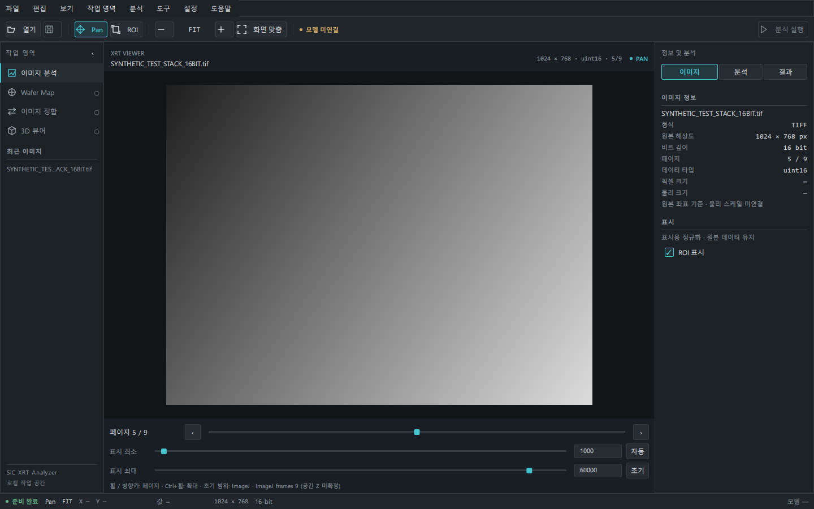
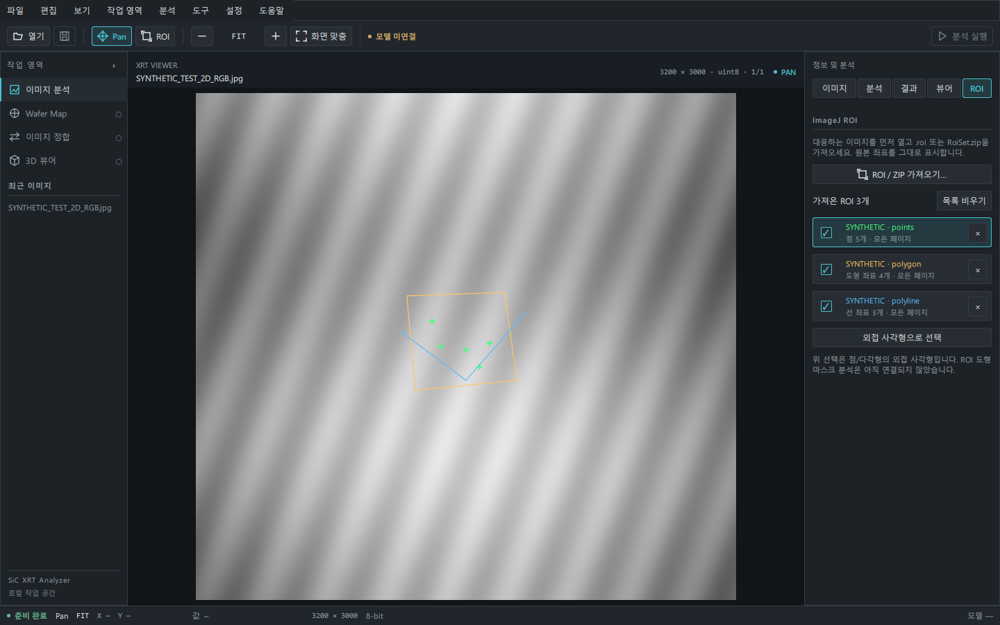
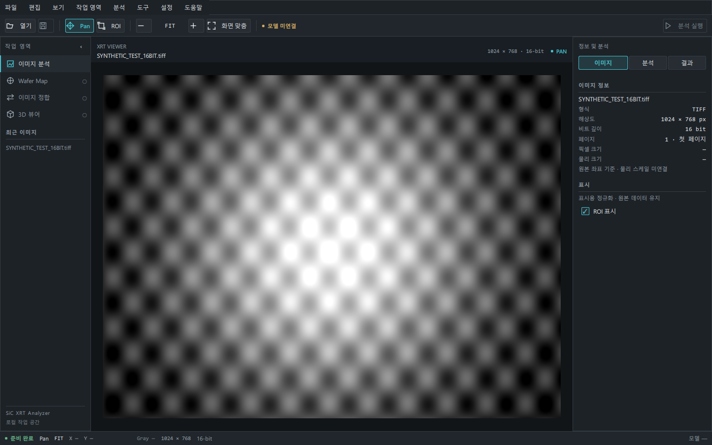
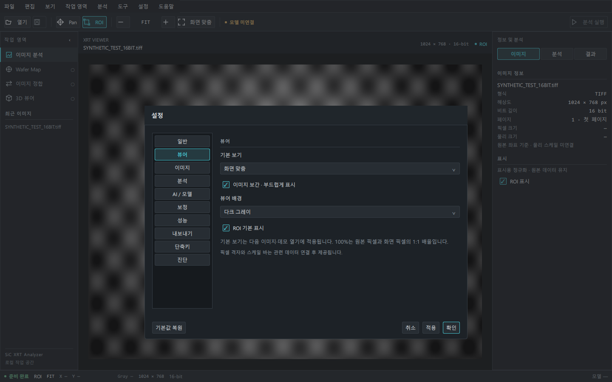

# sic-xrt-analyzer

## Windows 설치·다운로드 사이트·관리자 포털

현재 PC 배포 사이트: `http://127.0.0.1:18770`. React/TypeScript/Tailwind 다운로드·버전 이력과 관리자 연구 자료 조회를 제공합니다. 설치 프로그램은 GPLv3로 동작을 검증하고 동일 버전 앱·빌드 소스를 함께 제공합니다. [실행·배포·백업·검증 보고서](docs/deploy/XRT-DEPLOY-TD-01.md)를 참고하세요.


SiC XRT 이미지를 탐색하는 PySide6/QML 데스크톱 앱입니다. 산업용 Dark Gray 화면, 사전 준비된 정밀 TIFF 스택·JPG 뷰어, ImageJ 도구·ROI 편집과 앱 내부 ImageJ 매크로·Java 플러그인 실행 창을 제공합니다. **고정 연구 모델의 BPD·TED·TSD 후보 분류가 분석 버튼에 연결되어 있습니다.** [모델 연결·결과 저장 안내](docs/desktop-inference.md). 3D 재구성은 별도 개발 범위입니다.

## 실행 (Windows PowerShell)

Python 3.11 이상과 ImageJ 실행용 Java 17 이상이 필요합니다. Fiji/ImageJ2는 **Java 21 이상**이 필요합니다. Java가 PATH에 있어야 합니다. 저장소 폴더에서 실행합니다.

```powershell
cd D:\capstone\sic-xrt-analyzer
python -m venv .venv
.\.venv\Scripts\python.exe -m pip install -e ".[dev,viewer,imagej,research]"
.\.venv\Scripts\python.exe tools/setup_imagej.py
.\.venv\Scripts\python.exe -m sic_xrt_analyzer
```

이미 설치된 이 작업 환경에서는 아래 한 줄로 실행할 수 있습니다. 업데이트 후에는 위의 설치 명령으로 새 의존성을 반영하고 실행 중인 프로그램을 다시 시작하세요. 가상환경 활성화만으로 프로그램이 실행되지는 않습니다.

```powershell
.\.venv\Scripts\python.exe -m sic_xrt_analyzer
```

## 분석 프로젝트 저장과 이력 관리

**파일 → 새 분석 프로젝트 / 프로젝트 열기 / 최근 프로젝트**에서 작업을 관리합니다. 분석 후 **프로젝트 저장 (`Ctrl+Alt+S`)**으로 여러 JPG 원본과 여러 분석 실행을 하나의 `.json` 프로젝트에 보관합니다. 기존 `Ctrl+S`는 이미지 작업 복사본 저장입니다.

왼쪽 **프로젝트 · 이미지와 이력…**에서 원본·열처리 전후 역할·Run을 선택합니다. 저장된 후보·점수·원본 Crop·Overlay는 모델을 재실행하지 않고 표시합니다. 원본이 없으면 결과 메타데이터를 보여주고, **원본 다시 연결…**은 미리 검증된 SHA가 같은 파일만 허용합니다. SHA 확인에는 진행 표시와 취소가 있습니다.

원본 JPG/TIFF와 모델은 프로젝트에 복사하지 않습니다. 실험 근거를 추가하면 검증된 Geometry/Mask 번들을 프로젝트 옆 `assets/`에 보관하므로 `.json`과 해당 자산 폴더를 함께 옮겨야 합니다. TIFF는 스택·3D 원본 목록으로만 등록하며 후보 분류를 실행하지 않습니다. 다른 위치 저장은 같은 프로젝트의 복사본입니다. 별개의 새 프로젝트가 필요하면 새 분석 프로젝트를 생성하세요.

[저장 계약·실제 원본 검증·스크린샷·남은 제약](docs/result/XRT-RESULT-TD-04-PROJECT-WORKSPACE.md).

## ImageJ 작업창과 선명한 확대 표시

큰 이미지의 원본·표시 계층을 처음에 준비하여 확대·축소·스택 드래그 때 저해상도 화면으로 돌아가는 동작을 제거했습니다. 사진의 ImageJ 도구와 익숙한 메뉴 순서, 측정·히스토그램·선 프로파일, 필터·LUT, IJM 매크로 및 Java `PlugIn`/`PlugInFilter` 실행을 제공합니다. 처리 결과는 원본을 보존한 작업 복사본으로 내부 뷰어에 표시합니다. `Ctrl+S`로 새 이미지 파일 복사본을 저장하고 파일 메뉴에서 측정 결과 TSV를 저장합니다.

**TIFF는 ImageJ 선택·측정·처리 작업공간, JPG는 모델 분석 작업공간입니다.** Reader가 판별한 형식으로 Toolbar를 전환합니다. TIFF에서는 분석하기 버튼과 분석 ROI를 숨기고 사각형·타원·다각형·자유 영역·선·점·완드 아이콘을 제공합니다. 단일 TIFF도 기본 선택·측정·현재 페이지 ImageJ 처리를 지원하며 다중 페이지 스택 작업은 전체 준비 후 별도로 실행합니다. [TD-09 기능 매핑·화면·검증·제약](docs/result/XRT-RESULT-TD-09-TIFF-IMAGEJ-UX.md). JPG의 분석·결과·검수·프로젝트·모델 관리 흐름은 유지합니다. ImageJ frames를 물리 Z로 추측하지 않습니다.

스택을 연 뒤 **측정**에서 기준선의 픽셀 거리·실제 거리·단위를 설정하고 길이·면적·점 개수·각도를 측정합니다. 결과를 Excel에 붙여 넣거나 새 TSV로 저장할 수 있습니다. **플러그인 → Java 플러그인 등록 / 실행**에서 `플러그인 설정창 사용 (AWT/Swing)`을 켜면 해당 Java 창을 앱 내부에 연결합니다. Windows와 Linux X11/XWayland에서 지원합니다.

Fiji/ImageJ2는 다음 명령으로 Java 라이브러리를 설치하고, 작업창의 **Fiji 라이브러리…**에서 `artifacts/fiji-runtime`을 선택합니다. 외부 Fiji 앱을 실행하지 않습니다.

```powershell
.\.venv\Scripts\python.exe tools/setup_fiji.py
```

**모든 플러그인의 완전 호환은 보장하지 않습니다.** SciJava Command의 ImagePlus/Dataset/ImageDisplay 입력, 서비스 주입, JSON 인수와 이미지 결과 반환을 연결했습니다. Fiji 전체 스택의 편집용 복사본은 512 MiB까지이며 큰 XRT 스택은 현재 페이지로 처리합니다. 장치·JavaFX·임의 매크로 마우스 도구 등은 별도 연결이 필요합니다. [사용법·설치·검증·제약](docs/stack-plugin-compatibility.md) · [기존 정밀 표시 구현](docs/imagej-workbench.md).

선택한 ROI를 Fiji Overlay로 전달하여 선택 영역을 사용하는 명령을 실행합니다. 사각형·타원·다각형·자유영역·선·점을 원본 좌표로 연결하며, Dataset만 처리하는 명령은 ROI를 무시할 수 있습니다. 실제 3D XRT TIFF 4개에서 첫·중간·마지막 페이지, 밝기·대비, 연속 탐색, 확대·이동, Fiji ROI 처리와 재열기·캐시 정리를 확인했습니다. [시간·메모리·제약과 검증 재현](docs/stack-validation.md).

**XRT-UX-TD-09 당시 RC 판정: FAIL / NOT RC READY.** 실제 TIFF 4개와 RGB 모델 분석을 검증했지만 Windows 파일 선택창 반복 열기·취소에서 접근 위반 종료가 재현됐습니다. [TD-09 검증 결과·재현·제약](docs/ux/XRT-UX-TD-09-RC-VALIDATION.md). 신규 검사 3개를 포함한 회귀 검사 수는 **261개**, Windows AWT/Swing/ImageJ 창 검사 **4개**, 총 **265개**입니다. 최종 HEAD의 검사·CI 완료 결과는 TD-09 PR에 기록합니다. [TD-08 시각 위계](docs/ux/XRT-UX-TD-08-VISUAL-DENSITY.md) · [TD-07 로딩 검증](docs/ux/XRT-UX-TD-07-TIFF-LOADING.md). 아래 이전 단계의 테스트 수는 당시 기록입니다.

## 화면과 조작

### 전역 시각 위계 (XRT-UX-TD-08)

Context 제목 15px, 본문 13px, 보조 12px, 기술 정보 11px로 통일했습니다. 입력/일반 버튼 32px, 대표 분석 실행 36px, Toolbar 32px를 사용합니다. 일반 패널·버튼·Section의 중복 테두리를 줄이고 선택·입력·키보드 focus를 구분합니다. 메뉴·작업 흐름·영상 표시·원본 좌표는 기존 동작을 유지합니다.

일반 우측 패널 282px·결과 패널 380px와 Viewer 면적은 그대로입니다. 목록의 글자·간격을 키워 독립 목록 스크롤은 일부 증가했습니다. 합성 이미지로 17개 상태의 1100×700·1440×900 변경 전후 화면과 1920 결과 화면을 기록했습니다. [토큰·측정·70장 비교·DPI·남은 제약](docs/ux/XRT-UX-TD-08-VISUAL-DENSITY.md) · [최소 화면 분석](docs/screenshots/visual-td08/after/analysis-ready-1100.png) · [결과 검토](docs/screenshots/visual-td08/after/result-bpd-1100.png).

### 화면 정보구조 (XRT-UX-TD-01)

화면을 **전체 명령 메뉴 · 뷰어 조작 Toolbar · 작업/파일 탐색 · 중앙 이미지 · 우측 작업 Context · 하단 상태**의 6개 영역으로 분리했습니다. 왼쪽의 현재 이미지로 이미지 작업 영역에 복귀하고, 오른쪽 분석 Context에서 공유 실행/취소 Action을 사용합니다. 5개 Context는 아래 TD-03의 작업 선택 메뉴로 접근합니다. [컴포넌트 구조·기능 중복 Inventory·후속 TD](docs/ux/XRT-UX-TD-01-IA.md).

### Toolbar 단순화 (XRT-UX-TD-02 당시 기록)

상단 왼쪽은 **열기 | Pan · Zoom · 화면 맞춤 | ROI ▾ · 측정 ▾ | ⋯**, 오른쪽은 **패널 ▾ · 분석하기**로 구성합니다. ROI 메뉴에서 분석 영역(`R`) 또는 스택의 사각형·타원·다각형·자유영역·점·완드를 선택합니다. 측정 메뉴에는 선·각도·점·텍스트·화살표와 측정/보정 창이 있습니다. 선택한 도구는 기존 Accent와 이름·아이콘으로 표시하며 메뉴를 닫은 뒤 이미지에서 바로 사용합니다. `H`로 Pan, Zoom 도구에서 클릭으로 확대·Alt+클릭으로 축소합니다.

저장(`Ctrl+S`)·추가 배율·ROI 편집, 스택 페이지/투영/복제/반전, LUT, 그리기·색 추출, ImageJ 명령·매크로·Java 플러그인·Fiji는 **⋯**에서 사용합니다. 분석 실행/취소는 오른쪽 **분석 Context**과 **분석 메뉴**에서 같은 Action으로 실행합니다. [구성·진입점·검증·제약](docs/ux/XRT-UX-TD-02-TOOLBAR.md) · [1100×700 화면](docs/screenshots/toolbar-td02/stack-1100.png).

### 작업 Context (XRT-UX-TD-03)

상단 **패널 ▾**에서 이미지 정보·분석·결과·뷰어/스택·ROI 관리를 선택합니다. 왼쪽 **이미지 뷰어**는 JPG/JPEG와 TIFF의 공통 작업 영역입니다. 둘 다 기본 우측 패널을 접어 넓게 표시하며, TIFF의 페이지·밝기/대비는 **패널 ▾ → 뷰어·스택**에서 엽니다. TIFF 전체 준비는 이미지 위 중앙에 회전 표시·페이지 진행률·취소 버튼으로 보여주고 준비 완료 시 사라집니다. 확장자 대소문자와 관계없이 디코더가 확인한 실제 형식을 사용합니다. **패널 ▾** 또는 **⋯ → 뷰어·스택 표시 설정**에서 수동으로 변경할 수 있습니다. [파일별 화면 전환](docs/ux/FILE-CONTEXT-ROUTING.md). 분석 설정은 스크롤하고 실행·취소·상태는 하단에서 확인합니다. 정상 완료는 후보 0개도 결과로, 실패/취소는 분석으로 연결됩니다. 후보를 명시적으로 선택하면 기존 상세·Focus를 유지합니다.

Pan·Zoom·ROI 도구 선택·페이지 이동·hover·로딩 진행은 현재 Context를 바꾸지 않습니다. ROI 관리자·가져오기·편집을 요청하면 ROI 관리로 이동하고 분석 영역과 ImageJ 도형을 별도로 표시합니다. 방향키/Enter/Escape로 작업 선택 메뉴를 조작하며 닫은 후 Viewer 포커스를 복구합니다. [전환 규칙·상태·검증·제약](docs/ux/XRT-UX-TD-03-CONTEXT.md) · [Context 선택 화면](docs/screenshots/context-td03/switcher-1100.png).

### 단일 화면 분석 (XRT-UX-TD-04)

상단 우측 **분석하기**는 분석 준비 화면으로 이동합니다. JPG/JPEG와 TIFF 모두 기본 오른쪽 패널을 접어 Viewer를 넓게 표시합니다. **패널 ▾**에서 이미지 정보·뷰어/스택·ROI·결과를 열고, 패널의 **×** 버튼으로 다시 넓게 볼 수 있습니다. 모델 준비 여부·분석 범위·원본 입력·실행 가능 이유를 한 화면에서 확인합니다. 기본 범위는 **전체 이미지**이며 모델이 지원하면 **분석 실행 한 번**으로 시작합니다. 지정 영역을 선택하면 **영역 지정 (R)**을 누르고 이미지에서 드래그합니다. 분석 Context를 유지하며 영역 상태가 즉시 갱신됩니다.

후보 방식·좌표 CSV는 **고급 설정**, 모델 hash/폴더/device와 입력 경로는 **상세 정보**에서 확인합니다. 실행 중 모델·범위·분석 영역 설정은 잠기고 Pan/Zoom은 계속 사용할 수 있습니다. 취소·실패 후 설정을 유지하고 **다시 분석**합니다. 완료하면 후보 0개도 결과 Context로 연결됩니다. ImageJ ROI 기록은 자동 분석 범위가 아닙니다. [실제 준비 조건·클릭 수·검증·제약](docs/ux/XRT-UX-TD-04-ANALYSIS-FLOW.md) · [1100×700 준비 화면](docs/screenshots/analysis-td04/ready-1100.png).

### 결과 검토 (XRT-UX-TD-05)

오른쪽 **결과**에서 **총 후보 수 → 색상과 이름을 함께 표시한 Class 필터 → 현재 후보 번호 → 선택 분류·모델 점수 → 목록** 순서로 검토합니다. `이전/다음`은 현재 필터 기준이며 Class 변경 시 포함된 선택은 유지하고 제외된 선택은 해제합니다. 일반 Overlay는 약하게, 선택 후보는 기존 노란 강조선으로 표시합니다. 목록만 스크롤하므로 1100×700에서도 요약과 선택 상세를 계속 확인할 수 있습니다.

점수는 기본 퍼센트, **상세…**에서 원본 raw score·ID·좌표·복사를 제공합니다. **탐색 설정…**에 기존 검색·낮은 점수·자동 ROI·표시 설정을 모았습니다. **전체 결과 저장…**은 필터와 관계없이 모든 원본 결과를 저장합니다. 분류·score·좌표·알고리즘·Export 데이터는 변경하지 않았으며 모델 점수는 정답 확률이 아닙니다. [구조·상태·Overlay 정책·검증·제약](docs/ux/XRT-UX-TD-05-RESULT.md) · [1100×700 결과 화면](docs/screenshots/result-td05/bpd-selected-1100.png).

### ROI 상태·생성·편집·관리 (XRT-UX-TD-06)

오른쪽 **ROI 관리**는 **분석 영역 상태 → ImageJ ROI 개수·현재 선택 → 가져오기·관리·편집 → 기록 목록 → ZIP 저장** 순서로 표시합니다. 분석 영역은 분석에 전달하는 사각형이며, ImageJ ROI는 별도의 도형·점·선 기록입니다. 전체 이미지 분석에는 영역 지정이 필요하지 않습니다.

**영역 지정 (R)**은 Toolbar·분석 Context·ROI Context에서 같은 Action을 사용합니다. 드래그 중/완료/분석 중 잠금을 표시하며 ROI Context에서 다시 지정·제거할 수 있습니다. ImageJ 도형은 기존 Toolbar에서 선택하여 Viewer에 그립니다. Polygon/Polyline은 Enter 또는 더블클릭으로 완료하고 Esc로 미완성 도형을 취소합니다. 도구·페이지를 바꾸면 미완성 입력을 정리합니다. 도구 선택과 그리기는 현재 Context를 유지하고, 가져오기·관리·편집 요청만 ROI 관리로 이동합니다.

기존 ROI 관리자는 이 패널의 목록입니다. **편집 / 편집 종료**는 같은 Action으로 연결하며, 원본 좌표·이름·꼭짓점·실행 취소/다시 실행과 **분석 영역으로 외접 사각형 선택**은 **세부 설정…**에서 제공합니다. 도형이 자동 분석 범위로 바뀌지는 않습니다. 오류 상세는 별도 창에서, 긴 목록은 독립 스크롤로 확인합니다. 기존 원본 보존·새 ZIP 복사본 저장을 유지합니다. [상태·조작·페이지 의미·검증](docs/ux/XRT-UX-TD-06-ROI.md) · [1100×700 화면](docs/screenshots/roi-td06/selected-1100.png).

### TIFF / Stack 로딩 (XRT-UX-TD-07)

첫 페이지의 원본·정밀 표시 준비가 끝나면 중앙 로딩 화면을 제거하여 **Pan·Zoom·Fit·원본 픽셀 확인·분석 영역 지정**을 사용할 수 있습니다. 분석 실행은 기존 원본 source·모델·범위 조건이 충족될 때 가능합니다. 나머지 페이지 준비는 백그라운드에서 계속되며 상태 표시줄과 **뷰어·스택** Context에서 실제 준비 페이지 수를 확인합니다. Context는 진행률 때문에 바뀌지 않습니다.

**현재 페이지 P/T**와 **Stack 준비 N/T 페이지**는 별도입니다. 페이지 이동·밝기/대비·ImageJ 작업과 이미지 복사본 저장은 기존 전체 준비 조건을 유지합니다. 준비 실패 시 현재 이미지를 유지하고 **다시 준비 / 상세 정보…**, 열기 실패 시 **다시 열기…**를 제공합니다. 준비 취소·닫기는 기존 `Ctrl+W`와 같은 동작입니다. 큰 단일 TIFF/JPG는 정밀 표시 계층을 먼저 준비합니다. [구조·상태·조작 조건·실측](docs/ux/XRT-UX-TD-07-TIFF-LOADING.md) · [1100×700 준비 중 화면](docs/screenshots/loading-td07/stack-preparing-1100.png).

### Linux에서 실행

저장소 디렉터리에서 Python 3.11 이상으로 실행합니다. Qt 그래픽 세션이 필요합니다.

```bash
python3 -m venv .venv
.venv/bin/python -m pip install -e '.[viewer,imagej]'
.venv/bin/python tools/setup_imagej.py
.venv/bin/python -m sic_xrt_analyzer
```

`viewer`는 스택 보기의 필수 패키지만 설치합니다. [Linux 시스템 의존성과 스택 안내](docs/tiff-stack-viewer.md)를 참고하세요.

- **메뉴**: 파일 · 편집 · 이미지(Image) · 처리(Process) · 분석(Analyze) · 플러그인(Plugins) · 창(Window) · 도움말. `Alt+F/E/V/W/A/T/S/H`와 방향키, Enter, Escape로 조작합니다.
- **Primary Toolbar**: 열기, Pan, Zoom, 화면 맞춤, ROI/측정 드롭다운, 추가 도구(⋯). 스택 전문 도구는 드롭다운/추가 도구에서 사용합니다. Viewer 내부에는 중복 명령 툴바를 두지 않습니다.
- **Workspace Navigator**: 이미지 분석, Wafer Map, 정합, 3D와 최근 파일. 이미지 분석 외 작업 영역은 준비 안내 화면입니다.
- **Viewer**: `Ctrl+O` 또는 파일 드롭으로 TIFF/JPG/JPEG를 엽니다. 작업 선택 메뉴의 **뷰어·스택**의 슬라이더·이전/다음 버튼, 이미지 위 휠·방향키로 페이지 이동, Ctrl+휠로 확대합니다. 페이지 탐색과 밝기·대비 조절을 사이드바에 모아 이미지 영역의 높이를 확보했습니다. 기본 **FIT**는 원본 종횡비와 전체 이미지를 유지하며 가장자리에 8px 여백으로 크게 맞춥니다. 설정에서 선택한 기본 배율도 유지합니다. Pan(`H`), ROI(`R`), 화면 맞춤(`Ctrl+0`), 확대·축소(`Ctrl++/-`)를 지원합니다. **100%는 원본 픽셀과 화면 물리 픽셀의 1:1**입니다. 이미지 메뉴 또는 `Ctrl+1`로 실제 크기를 표시합니다.
- **Right Context**: 현재 작업 선택 메뉴에서 IMAGE(메타데이터), ANALYSIS(준비·실행·상태), RESULT(후보·상세·Export), VIEWER(페이지·밝기/대비), ROI(분석 영역·ImageJ 기록·편집)에 접근합니다. 편집 메뉴의 프로그램 설정은 Context를 바꾸지 않습니다.
- **Status Bar**: 로딩·이미지·ROI·파일 오류 상태, 도구, 배율, 원본 픽셀 좌표와 실제 원본 값, 해상도와 비트 깊이. 미연결 물리 스케일·모델·장비는 `—`로 표시합니다.
- **이미지 메뉴**에서 패널과 상태 표시줄을 숨기고 전체 화면(`F11`) 또는 화면 배치 초기화를 사용합니다. 기본 1440×900, 최소 1100×700입니다.
- `Ctrl+W`로 현재 이미지를 닫고 `Ctrl+Q`로 종료합니다. ROI 좌표는 편집 메뉴에서 복사합니다.

### TIFF 표시 범위

숫자형 회색조, 인터리브 RGB/RGBA의 단일 이미지와 multi-page TIFF/BigTIFF, ImageJ contiguous 스택을 표시합니다. 16비트 원본을 유지하고 별도의 표시 범위를 8비트 QImage로 변환합니다. ImageJ min/max 또는 Ranges가 있으면 초기 범위로 사용하며, 없으면 첫 페이지 자동 범위를 사용합니다. 최소/최대 슬라이더·숫자 입력과 자동/초기로 범위를 조절합니다. MINISWHITE와 압축 디코딩을 지원합니다. 긴 변 4096픽셀 이하의 미리보기를 만들며 메타데이터·마우스 좌표·ROI·픽셀값은 **원본 기준**입니다.

디코딩은 백그라운드에서 수행합니다. 첫 정밀 frame 전에는 이미지 명령을 잠그고, 이후에는 실제 준비 조건에 따라 조작을 활성화합니다. 실패하면 짧은 안내와 오류 상세 창을 제공하고 이전 이미지를 유지합니다. 성공한 파일만 최근 목록에 기록합니다. 파일 선택 창을 취소하면 현재 이미지는 유지됩니다. 종료 시 진행 중인 디코딩이 끝날 때까지 기다립니다.

파일을 열 때 중앙에는 **파일 여는 중**을 표시하고, **첫 정밀 frame이 준비되면 전체 스택 완료 전에도 현재 페이지를 사용할 수 있습니다.** 실제 준비 count는 상태 표시줄과 뷰어·스택 Context에 표시합니다. 전체 탐색 화면이 준비되면 스크롤·슬라이더·방향키와 표시 범위 변경을 활성화합니다. 준비 실패 시 현재 frame을 유지하며 `다시 준비` 또는 `준비 취소·닫기`를 선택할 수 있습니다. 로딩 중에도 새 파일 열기와 취소/닫기(`Ctrl+W`)는 가능합니다.

드래그 중에는 기본 긴 변 1024픽셀 이하의 탐색 화면을 표시하고, 손을 놓은 마지막 페이지는 정밀하게 읽습니다. 휠/키 이동도 준비된 화면을 먼저 표시합니다. 탐색 화면은 **최대 512 MiB** 안에서 전체 페이지의 원본 dtype 샘플과 8비트 화면을 보관하며, 필요하면 샘플 크기를 줄입니다. 밝기·대비를 바꿔도 전체 캐시를 유지합니다. 원본 픽셀값은 정밀 읽기 후에만 표시하고 그전에는 `—`입니다.

원본 전체 스택 배열은 만들지 않습니다. raw 캐시는 **최대 3페이지/96 MiB**, 정밀 표시 캐시는 **32 MiB**입니다. 압축·비매핑 TIFF는 **페이지당 64 MiB**의 디코딩 한도, 원본 반환은 128 MiB 한도를 적용합니다. 빠른 이동은 최신 요청을 우선 처리하며 파일 교체·닫기 시 전체 탐색 캐시도 정리합니다. 이 값들은 캐시 버퍼 한도이며 프로세스 전체 RAM 한도는 아닙니다. 축소 시 Inspector에 **원본 해상도와 표시 미리보기 크기**를 따로 표시합니다.

원본 TIFF 파일은 수정하지 않습니다. 1:1은 원본 좌표 격자의 표시 배율입니다. 대형 단일 2D TIFF/JPG와 축소 탐색을 사용하는 스택은 처음에 정밀 표시 계층을 준비합니다. 확대·이동·페이지 드래그 중에 필요한 해상도를 즉시 선택하여 그립니다. ImageJ LUT와 측정 스케일 설정도 제공합니다. 물리 스케일 메타데이터의 자동 해석과 범용 GPU tile streaming은 별도 범위입니다. ImageJ frames를 공간 Z축으로 가정하지 않습니다. 3D는 순서·방향·실제 간격 확인 이후 별도 단계입니다.



**스택 검증:** 기존 42개 + 스택 17개 + 탐색 성능 회귀 8개 + 전체 탐색 10개 + 초기 로딩 잠금 3개 = **80개 테스트**. 3000×3000 uint16 158장 생성 TIFF에서 전체 준비 후 앞뒤 632회 이동 중 추가 디코딩 0회를 확인했습니다. QML 마우스로 슬라이더를 누른 채 이동하고 놓을 때 마지막 페이지만 정밀 읽는 것도 검증했습니다. 준비 중 입력 차단·100% 후 활성화·실패 시 재시도·취소를 검사했습니다. [구현·성능 측정·검증·제약 문서](docs/tiff-stack-viewer.md)에 기록했습니다. 현재 Windows 환경에서 제공하신 Linux 경로에 접근할 수 없어 **실제 XRT 파일 4개 검증은 아직 미수행**입니다. 해당 Linux에서 다음 읽기 전용 검증 도구를 실행할 수 있습니다.

```bash
.venv/bin/python tools/validate_tiff_stack.py \
  --folder '/run/media/didgmltmd/6E25-3446/3D XRT'
```

### JPG·대형 2D TIFF·ImageJ ROI

**정밀 표시 사전 준비·ROI 편집 추가:** 큰 JPG는 열기 단계에서 원본 해상도로 한 번 디코딩하고 임시 디스크 캐시가 준비된 뒤 뷰어를 엽니다. 이후 확대/Pan에 JPG 재디코딩을 하지 않습니다. ROI 관리에서 점·꼭짓점 드래그, 좌표 수정, 추가·삭제, 전체 이동, 실행 취소/다시 실행과 **새 ZIP 복사본 저장**을 제공합니다. 원본은 덮어쓰지 않습니다. [사용법·검증·제약](docs/prepared-viewer-roi-editor.md)에 기록했습니다. 현재 자동 검사는 **117개**이며 아래 95개와 파일 수는 Issue #25 당시 검증 기록입니다.

- JPG/JPEG를 파일 선택·드롭·최근 파일에서 열고 FIT/Pan/Zoom/밝기·대비를 사용합니다. 메타데이터는 원본 해상도를 표시하며 상태 표시줄 RGB값은 표시 범위 변환 전 JPEG 디코딩 값입니다.
- 약 12k×12k RGB TIFF처럼 원본 페이지가 128 MiB를 넘으면 읽기 전용 mmap에서 제한된 미리보기만 만듭니다. 전체 RGB 배열을 복사하지 않습니다. 처음에 표시 계층을 준비하고 현재 배율에 맞는 영역을 그리며, 정확한 커서 픽셀값도 별도 영역 읽기로 조회합니다.
- 이미지를 연 뒤 **파일 → ImageJ ROI 가져오기** 또는 오른쪽 **ROI 관리 → 가져오기**에서 `.roi` 여러 개나 `RoiSet.zip`을 선택합니다. 점·다중 점·다각형·사각형·타원·선을 원본 좌표에 표시하며 개별 숨김·선택·목록 제거가 가능합니다. ZIP은 압축을 풀지 않고 읽습니다.
- ROI 관리의 **세부 설정… → 분석 영역으로 외접 사각형 선택**을 누르면 기존 분석 사각형에 연결됩니다. TIFF/JPEG 모두 기본 ROI 가져오기·편집을 지원하고, 고급 ImageJ 처리는 TIFF 스택에서 제공합니다. 승인 모델의 다각형·점 마스크 분석은 미연결이며 TIFF 모델 분석 입력 계약 1.0은 유지합니다.
- 새 이미지 열기 성공·닫기 시 가져온 ROI와 읽기 캐시를 정리합니다. ROI 파일명으로 이미지 대응을 추측하거나 좌표를 자동 확대하지 않으므로 대응하는 이미지에서 가져오세요.

2026-10-02 Windows 실제 데이터에서 **정상 JPG 346개·대형 2D TIFF 9개**의 열기·밝기/대비·원본 부분 읽기와 **ROI 86개**의 파싱을 검증했습니다. JPG 1개는 원본부터 JPEG 형식이 아니고, ROI 2개는 빈 파일입니다. 실제 QML에서도 JPG 1개·TIFF 9개의 확대 정밀 표시와 ROI 외접 좌표를 확인했습니다. 기존 80개에 이번 회귀 검사 15개를 추가하여 **총 95개 테스트**를 사용합니다.



[100% 정밀 영역](docs/screenshots/2d-roi/jpeg-roi-100-detail.png) · [1100×700](docs/screenshots/2d-roi/jpeg-roi-1100.png) · [사용법·메모리 한도·검증 결과·제약](docs/2d-image-roi-viewer.md). 위 캡처는 임시 생성 데이터이며 실제 XRT 이미지는 Git에 포함하지 않습니다.

### 설정

`설정 → 설정…`에서 독립 Modal Dialog를 엽니다. 일반 / 뷰어 / 이미지 / 분석 / AI·모델 / 보정 / 성능 / 내보내기 / 단축키 / 진단의 10개 카테고리를 제공합니다.

실제 적용 항목: 시작 시 데모, 최근 파일 보관 및 개수(1~10), 이미지 보간, 배경, 기본 보기, ROI 기본 표시. 사용자별 QSettings에 저장합니다. 보관을 끄면 저장된 최근 목록을 삭제하고 세션 목록만 유지합니다. 기본 보기은 다음 이미지/데모 열기부터 적용합니다.

- **취소**: 마지막 적용 이후의 변경을 폐기합니다.
- **적용**: 저장·반영하고 창을 유지합니다.
- **확인**: 저장·반영하고 창을 닫습니다.
- **기본값 복원**: 확인 후 기본값을 즉시 적용합니다.

미연결 모델·분석·보정·성능·내보내기·로그 설정은 설명으로만 표시합니다. 테마와 언어는 현재 고정입니다. 분석 실행/취소/결과, 프로젝트 저장, Export, 측정, 결함·스케일·격자 레이어도 비활성 상태입니다.

## 화면 캡처와 검증

다음은 **Windows의 실제 Qt 렌더링**입니다. TIFF 화면은 생성한 테스트 데이터이며 실제 검사 데이터가 아닙니다.





[ROI](docs/screenshots/polish/02-main-roi.png) · [분석](docs/screenshots/polish/03-analysis.png) · [결과 없음](docs/screenshots/polish/04-result-empty.png) · [설정 일반](docs/screenshots/polish/05-settings-general.png) · [1100×700](docs/screenshots/polish/07-minimum-1100x700.png)

[메뉴](docs/screenshots/polish/menu-file.png) · [설정 메뉴](docs/screenshots/polish/menu-settings.png) · [복원 확인](docs/screenshots/polish/settings-reset-confirm.png) · [파일 오류](docs/screenshots/polish/error-retained.png) · [프로그램 정보](docs/screenshots/polish/about.png)

**Production 분석은 미연결**: 승인된 모델이 없습니다. 분석 기반의 Running / Completed / Failed / Canceled, 원본 좌표 변환과 stale 방지는 테스트 전용 어댑터로 검증합니다. Production에서 가짜 결함·GPU·시간을 생성하지 않습니다. Windows 캡처는 QTest로 조작했습니다. OS 네이티브 파일 선택 창의 열기/취소를 마우스로 수동 확인한 것은 아닙니다.

```powershell
.\.venv\Scripts\python.exe -m ruff check .
.\.venv\Scripts\python.exe -m pytest -q
.\.venv\Scripts\python.exe tools/capture_workstation.py
```

[Polish TD와 최신 검증 기록](docs/td-ui-polish.md) · [이전 통합 TD](docs/td-industrial-ui.md)

## 분석 기반 (모델 미연결)

Viewer의 8비트 QImage와 **OriginalImageSource**를 분리했습니다. 분석 입력은 원본 TIFF에서만 읽으며 uint16/float32의 값과 dtype을 유지합니다. `read_region()`은 원본 픽셀의 엄격한 ROI, `read_full()`은 명시적 전체 읽기입니다. 원본 반환 배열 한도는 기본 128 MiB, 비매핑 페이지 디코딩 한도는 64 MiB입니다.

불변 AnalysisRequest/AnalysisResult, ModelAdapter 입출력 계약, Qt 백그라운드 AnalysisPipeline과 협력 취소를 제공합니다. 새 파일·페이지·요청·원본 변경은 이전 작업과 결과를 무효화합니다. ROI만 바꾸면 결과를 유지하고 범위 차이를 추적합니다. UI는 실제 pipeline 상태를 받으며 **모델 미연결로 분석 실행은 비활성화**됩니다. 모델 연결 이후 분석 범위는 전체 이미지/ROI 중 명시적으로 선택해야 합니다.

분석 기반 TD의 42개 테스트에 스택·탐색 성능 38개, 2D 이미지·ROI 회귀 15개, 사전 준비·편집 9개, 정밀 표시·ImageJ 실행 13개를 추가하여 **117개 테스트**로 검증합니다. [계약·좌표·대용량 한계·오류·검증 문서](docs/analysis-pipeline-contract.md)를 참고하세요. 승인 모델, 실제 inference, 분석 결과 Overlay, 결함 목록, 분석 결과 Export는 다음 TD 범위입니다.

## 구조와 경계

`ui/`의 QML 구성요소와 공통 상태·액션, Python 파일/설정 브리지, `imaging/`의 분리된 TIFF 원본·미리보기, `analysis/`의 계약·어댑터 Protocol·파이프라인으로 구성됩니다. 공통 Theme·Icon·Button·Checkbox·ComboBox·Slider·Menu·Dialog·InfoRow·SectionHeader·StatusIndicator를 사용합니다.

웨이퍼 맵, 정합, 3D 및 승인된 ONNX 추론은 이 저장소 경계에 속하지만 현재 연결되지 않았습니다. 학습·평가는 sic-xrt-ml, 데이터 변환·검증은 sic-xrt-data-tools에서 담당합니다. 외부 모델 계약 변경은 별도 Issue에서 버전·해시·입출력 규약을 정합니다. 이번 UI 변경은 외부 모델 계약을 변경하지 않습니다.

작업 규칙: [AGENTS.md](AGENTS.md), [공통 handbook](https://github.com/CrystalVision-Lab/engineering-handbook).
## Jupyter 고정 모델 분석·전후 추적

연구용 고정 모델의 패치 분류, 후보 위치 표시·CSV 저장, 열처리 전후 자동 정렬과 잠정 연결은
[Jupyter 연구 분석 안내](docs/research-workflow.md)와 `notebooks/06_research_analysis.ipynb`에서 사용할 수 있습니다.
이 기능은 데스크톱 GUI의 분석 버튼과 별개입니다. 재학습 없이 실행하며 연결/종류 변화는 확정 정답으로 저장하지 않습니다.

## Windows 파일 선택창 안정성 (TD-10)

Windows는 Qt Widgets의 native modal picker 경로와 명시적인 수명 관리를 사용합니다.
다른 OS는 기존 QtQuick 선택창을 유지합니다. 실제 마우스 검증은 아직 PENDING이며 RC 승인 단계가 아닙니다.
진단·반복 검사·알려진 제약은 [TD-10 검증 기록](docs/ux/XRT-UX-TD-10-NATIVE-DIALOG-CRASH.md)을 참고하세요.

## 모델 입력 사전 검사 (TD-11)

분석 화면은 현재 원본 입력과 모델 요구 형식을 미리 비교합니다. RGB8 연구 모델에서
16비트 단일 채널 TIFF는 분석 실행만 비활성화되고 Viewer·Stack·ROI·ImageJ·저장은 유지됩니다.
현재 입력과 모델 요구는 분석 화면에, dtype·채널·정규화 정책은 기존 상세창에 표시합니다.
자동 uint16→uint8/Gray→RGB 변환은 추가하지 않았으며 backend 검증도 유지합니다.
[계약·상태·검증·잔여 RC blocker](docs/ux/XRT-UX-TD-11-MODEL-INPUT-PREFLIGHT.md)를 참고하세요.

### TD-12 Windows 이벤트 안정화 / RC 검증

닫힌 메뉴의 ancestor visibility와 feature availability를 분리해 첫 팝업 항목의 높이·클릭 경로를 안정화했습니다. 기존 Toolbar/Context/ROI/분석 테스트는 수정하지 않았습니다.
Windows 전체 293개 검사 × 3회, native plugin4개, native Open100/Save100/교차10 자동 반복 및 실제 TIFF4개·RGB JPG/모델/Export 검증을 완료했습니다.
**RC CODE READY — MANUAL VALIDATION PENDING**: OS 파일창 실제 mouse 조작과 종료 직후 focus 복귀는 아직 미검증입니다. Draft PR #79 및 [TD-12 보고서](docs/ux/XRT-UX-TD-12-RC-STABILIZATION.md)의 수동 절차/제약을 확인하세요. 병합하지 않았습니다.


## 독립 원본 점 라벨 검수

전체 주석·대비 후보를 원본 좌표에서 검토하는 독립 [검수 창](docs/dataset-review-v1.md)을 제공합니다. [대표 표본 계획](docs/dataset-review-v1.md)을 선택해 첫 검수 목록을 제한할 수 있습니다. 사람의 직접 확인·수정 이력은 보존하며 자동 후보나 표본 검사를 전체 데이터셋 승인으로 처리하지 않습니다.

## 2026-10-12 PR 통합

누적 코드·검사·보고서를 main에 통합했습니다. 이전 단계의 Draft/미병합 문구는 당시 기록입니다. 실제 Windows 파일창 수동 Acceptance와 Qt 6.12 종료 오류, 모델 정확도 및 남은 Viewer 성능 검증은 미완료이며 코드 병합이 RC 승인을 의미하지 않습니다. GitHub Issue #86에서 정리 결과를 확인할 수 있습니다.


## 후보 검수 이력

결과의 **선택 후보 검수하기** 또는 현재 작업 메뉴의 **검수**에서 결함 유무·종류·원본 위치를 확인하거나 수정하고, 누락·중복·보류·되돌리기를 기록합니다. 기존 예측과 원본은 보존하며 클릭이 학습이나 모델 변경을 실행하지 않습니다. [저장·복원·내보내기 계약](docs/review-feedback.md).


## 분석 프로젝트 도메인·로컬 저장 기반 (RESULT-TD-01)

`results/` Python 서비스는 기존 AnalysisResult를 후보·모델 예측·결함 객체·검수 이력으로 구분하고, 버전이 있는 프로젝트 JSON을 원자적으로 저장·재불러옵니다. 후보를 실제 결함으로 자동 확정하지 않으며 기존 JSON/CSV Export와 별도 계약입니다. 프로젝트 저장 UI와 서버 동기화는 후속 단계입니다. [설계·API·실행 방법](docs/result/XRT-RESULT-TD-01-DOMAIN.md), [검증 결과와 제약](docs/result/XRT-RESULT-TD-01-RESULT.md).


## BPD 선형·분기 구조 실험 (RESULT-TD-02)

원본 ROI에서 국소 대비/Sato/Frangi를 비교하고 중심선·분기 Graph·영역 mask와 기존 BPD 후보 연결을 별도 실험 bundle로 저장합니다. 명시적 CLI만 제공하며 기본 분석은 기존 모델을 사용합니다. 새 구조는 미분류 RULE_BASED 제안이고 실제 정확도는 정답 데이터가 없어 PRELIMINARY입니다. [실행 방법·비교 결과·보존 검사·제약](docs/result/XRT-RESULT-TD-02-BPD-DETECTION.md).


## 결함 중심 결과 탐색 (RESULT-TD-03)

결과 화면은 **분류 후보 수**와 BPD/TED/TSD 분포를 요약하고 선택 후보의 원본 Crop을 보여줍니다. 목록 필터와 ‘결과 표시…’의 클래스·구조·선택·ImageJ ROI 레이어는 독립입니다. 목록은 펼쳐 검색·페이지 이동할 수 있으며 기존 후보 검수와 전체 CSV/JSON 내보내기를 유지합니다.

이미지를 연 뒤 결과 패널의 **실험 영역 불러오기…**에서 TD-02 출력 폴더를 선택하면 검증된 선형·분기 Graph·Mask를 원본 좌표에 표시합니다. 선이나 구조 목록을 선택하면 전체 형상으로 이동하고 원본 Crop·근거를 확인합니다. TIFF는 스택 탐색·향후 3D용으로 사용하며 이 GUI의 실험 결과 불러오기를 제공하지 않습니다. 원본 TIFF의 뷰어·ImageJ와 기존 RGB 모델의 uint16 입력 제한은 유지합니다. **자동 구조 제안은 실제 정확도 미검증이며 확정 결함이 아닙니다.** 프로젝트 전체 저장 UI와 구조 검수는 후속 단계입니다.

[구현·실제 XRT 검증·DPI 계측·화면 캡처·제약](docs/result/XRT-RESULT-TD-03-RESULT-UX.md).


## 프로젝트 연구원 검수 · 결함 영역 편집 (RESULT-TD-05)

JPG 분석 결과 또는 저장된 Run에서 후보·구조를 선택하고 **프로젝트 검수**를 누릅니다. 첫 검수 전에 로컬 연구원 ID를 설정하고 원본 SHA를 검증합니다. 원본 모델 예측과 개인의 결함 존재·종류·영역 판정은 별도로 보존됩니다. **검수 기록**은 프로젝트 메모리에 추가하고, **프로젝트 디스크 저장**은 JSON에 저장합니다. **디스크 저장 → 다음**은 저장 성공 후에만 이동합니다.

**영역 수정**에서 Point/Polyline/Polygon/Branch Graph의 제어점을 원본 좌표로 수정합니다. 점 이동·추가·삭제, Graph Edge 경로·연결 편집, Ctrl+Z/초안 복원/취소를 지원합니다. 저장하면 원본 도형과 별개인 HUMAN Geometry가 추가됩니다. **결함 추가**는 모델 후보·점수를 만들지 않는 수동 DefectInstance를 기록합니다. 자기 교차 Polygon·연결이 끊어진 Graph는 저장하지 않습니다. 원본 Mask는 유지하고 Polygon 보정을 사용합니다.

검수 목록에서 미검수·완료·수정·결함 아님·보류·충돌을 구분하고 이력의 연구원·부모·revision을 확인합니다. 서로 다른 연구원의 판정은 마지막 기록으로 자동 덮어쓰지 않습니다. 검수는 학습 정답 승인·재학습·서버 전송을 실행하지 않습니다. Legacy 검수는 별도 출처로 유지합니다. TIFF는 스택·ImageJ용이며 이 검수·편집의 대상이 아닙니다.

프로젝트 검수가 처음 추가될 때 Schema **1.1.0**을 사용합니다. **1.0.0** 파일의 읽기·저장 호환을 유지하며 구버전 상태에서 독립 판정을 추측하지 않습니다. 1.1.0은 이전 프로그램에서 지원되지 않습니다. [계약·검증·제약 보고서](docs/result/XRT-RESULT-TD-05-REVIEW-WORKSPACE.md).


## 중앙 연구 서버와 명시적 동기화 (TD-06)

프로젝트 작업 영역의 **중앙 서버**에서 저장된 분석·검수 기록을 인증된 localhost 서버로 전송할 수 있습니다. 자동 업로드는 OFF이며 API Credential은 OS Vault에 저장합니다. Crop은 검수한 JPG 원본 국소 영역을 별도 동의 후 lossless PNG로 전송합니다.

- [Windows 서버 시작·중지·백업·별도 복원](docs/server/DEPLOYMENT.md)
- [아키텍처와 버전 계약](docs/server/ARCHITECTURE.md)
- [인증·데이터 보호 정책](docs/server/SECURITY.md)
- [API 계약](docs/server/API.md)
- [TD-06 검증 결과](docs/result/XRT-RESULT-TD-06-CENTRAL-SYNC.md)

## Before/After JPG 정합·비교 (TD-10)

기존 프로젝트에 JPG 두 장을 등록·저장한 뒤 왼쪽 **이미지 정합**에서 Before/After를 직접 선택합니다. SHA 확인 후 SIFT/ORB, 제한된 Phase/ECC 또는 수동 Landmark를 실행하고 나란히/겹침/분할/차이를 비교할 수 있습니다. 원본 좌표와 분석·검수 기록은 유지하며 정합 자산을 별도로 저장합니다. 실패를 Identity 성공으로 처리하지 않습니다. 로컬 검수 승인과 실제 과학적 정확도는 별개입니다. TIFF는 기존 Stack/ImageJ 용도이며 정합 Source 목록에서 제외됩니다.

[구현·사용·검증·제약](docs/result/XRT-RESULT-TD-10-IMAGE-REGISTRATION.md)을 참고하세요.


## Wafer Map — JPG 배치와 저장 결과 탐색 (RESULT-TD-11)

프로젝트를 열고 왼쪽 **Wafer Map**에서 JPG를 선택한 뒤 **위치·회전·크기**로 배치하거나 드래그합니다. 이미지마다 하나의 완료 Run(Full/ROI)을 선택하고 BPD/TED/TSD·검수/HUMAN·실험 레이어를 탐색할 수 있습니다. 선택 대상을 원본 Viewer·결과·Before/After 비교로 열고, 편집자 ID와 함께 배치/Run/레이어를 저장·재열기·이력 복원합니다.

실제 좌표 근거가 없는 현재 데이터는 **단위 없는 임시 상대 배치**이며 실제 Wafer ID는 미확정입니다. 물리 모드는 실제 WaferID·좌표계·단위·origin·축·독립 기준점/측정 근거를 직접 제공해야 합니다. 합성 기준점 검사 성공을 실제 Wafer 정확도 검증으로 해석하지 않습니다. Full과 ROI를 합산하거나 후보를 실제 결함 총수로 표시하지 않습니다. TIFF는 기존 Stack/ImageJ·향후 3D용으로 유지합니다.

[사용법·좌표/저장 계약·실제 데이터 회귀·CPU 계측·69개 화면·남은 제약](docs/result/XRT-RESULT-TD-11-WAFER-MAP.md). 전체 상태는 **PARTIAL**, 임시 배치 구현 검증 완료/실제 물리 좌표 검증 미준비입니다. 실행은 D 프로젝트의 `.venv\Scripts\python.exe -m sic_xrt_analyzer`입니다.


## TIFF ROI 3D · 수동 페이지 관측 (RESULT-TD-12)

TIFF를 열거나 프로젝트에 등록하고 **3D 뷰어**에서 원본 사각 ROI·페이지 범위·샘플 간격을 지정한 뒤 **3D 생성**을 누릅니다. 원본 uint16 ROI는 최대 64 MiB로 추출하며 실제 Qt Quick 3D Perspective/Orbit/Pan/Zoom과 XY/X–Page/Y–Page 단면, 원본 픽셀 확인·2D 위치 복귀를 제공합니다. 연구원은 Point/Rectangle 수동 Track과 검수 상태를 로컬 프로젝트의 SHA 불변 Asset으로 저장할 수 있습니다. 재열기는 metadata 복원 후 명시적으로 ROI를 다시 생성합니다.

기본 축은 X/Y px + 원본 Page Index이며 **실제 물리 Z축 미검증(PHYSICAL_3D_NOT_READY)**입니다. 수동 Track은 **실제 동일 결함 확인 미검증(DEFECT_TRACKING_PRELIMINARY)**입니다. TIFF 결함 ML 분석·자동 추적·원본 수정·3D 서버 전송을 실행하지 않습니다. [실행·사용법·계약·실제 TIFF/합성 검증·계측·제약](docs/result/XRT-RESULT-TD-12-TIFF-3D-VIEWER.md).
