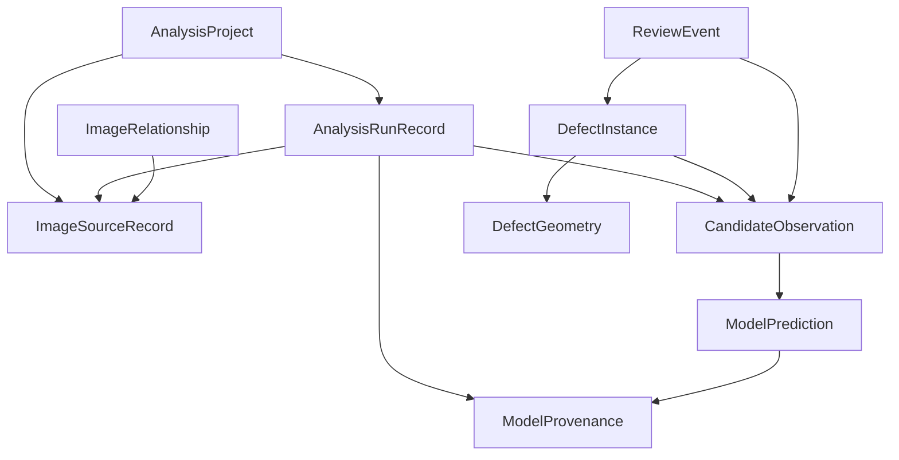

# XRT-RESULT-TD-01 — 분석 결과 도메인 및 저장 계약

- Issue: [#96](https://github.com/CrystalVision-Lab/sic-xrt-analyzer/issues/96)
- 시작: `feat/94-viewer-loading-ux`, `243155a3dbf58d015eaf08cca2202bd2b7b9dab9`
- 작업: `feat/96-result-domain-foundation`, D 드라이브
- 신규 저장 계약: `sic_xrt_analysis_project`, schema `1.0.0`
- 구현: `src/sic_xrt_analyzer/results/`. Python frozen dataclass와 기존 분석 계약을 사용한다.

## 1. 현재 분석 구조

```text
OriginalImageSource/JpegImageSource → contrast candidate proposals / supplied coordinates
→ original point → 128×128 RGB patch → frozen ONNX classification
→ AnalysisResult → ResearchController → ResultContext/ResultExplorer → JSON/CSV
```

`analysis/contracts.py`는 불변 Request/Result/Detection과 원본 좌표 Geometry를 정의한다. `pipeline.py`는 원본 ROI 읽기, 백그라운드 실행, 취소와 stale 결과 차단을 담당한다. `research.py`의 FrozenClassifier와 `desktop_adapter.py`는 고정 모델 검증과 실행을 담당하며 ModelAdapter Protocol은 `model_adapter.py`에 있다. `ui/research_controller.py`가 기존 후보 표시와 Export를 제공한다.

ROI Manager와 ImageJ ROI는 선택·분석 영역을 기록한다. ROI 자체는 결함의 실측 영역이 아니다. 새 도메인으로 자동 변환하지 않는다.

## 2. 현재 데이터의 한계

후보 탐색은 국소 밝기 대비 기반이며 모델은 패치 분류기다. 분할, 배경 판정, 실제 결함 수 산정 모델이 아니다. BPD/TED/TSD 출력은 보정된 정답 확률이 아닌 원본 분류 점수다. 동일한 BPD에 여러 후보가 생길 수 있다. 선형·분기형 실제 경계는 현재 모델에서 얻을 수 없다.

## 3. 후보와 결함 객체

`CandidateObservation`은 탐색·분류 결과를 보존한다. `DefectInstance`는 별도의 결함 객체와 형상·후보 연결을 보존한다. Adapter는 Observation만 만들고 DefectInstance는 **0개**로 유지한다. 후보 삭제, 자동 그룹화, BPD 선 연결, 분할 형상 생성은 수행하지 않는다.

명시적으로 생성한 한 Instance에 여러 Observation을 연결할 수 있다. `ObservationLink.link_status`는 PROPOSED/CONFIRMED/AMBIGUOUS이며 모호한 후보를 여러 객체에 연결해도 후보 자체는 보존된다. 연결 상태가 곧 과학적 검증이나 정답 승인은 아니다.

## 4. Domain Model

| 계약 | 역할 |
|---|---|
| AnalysisProject | 프로젝트 식별·시간·revision 및 모든 메타데이터 컬렉션 |
| ImageSourceRecord | 원본 참조·헤더·stat identity·선택적 검증 해시 |
| AnalysisRunRecord | 각 실행의 원본 snapshot·모델·파라미터·범위·시간·결과 |
| CandidateObservation | 원본 후보 ID·좌표·분류·raw score·metadata |
| ModelPrediction | Observation의 변경되지 않는 모델 예측과 provenance |
| DefectInstance / ObservationLink | 별도 결함 객체 및 명시적인 후보 연결 |
| DefectGeometry | 원본 좌표 형상 및 형상의 출처 |
| ReviewEvent | 개별 검수자 판단과 수정 이력 |
| ImageRelationship | 두 이미지의 역할과 정합 결과 연결 기반 |
| ModelProvenance | 모델 식별·입출력 계약·manifest snapshot |

컬렉션은 tuple, metadata는 재귀적으로 불변 Mapping이다. `project.evolve(...)`가 새 객체를 반환하며 revision과 updated_at을 올린다. 영구 ID는 UUID4 또는 namespace를 가진 UUID5이며 로컬 배열 인덱스를 식별자로 사용하지 않는다.

## 5. 관계와 무결성



전체 entity ID 중복, 모든 참조, 페이지 범위, 원본 좌표 범위, ROI, 모델·예측의 일치, 이벤트 부모와 revision을 검증한다. Observation마다 Prediction이 정확히 하나 있어야 한다. Geometry는 같은 원본·페이지에 연결한다. 수정 Geometry는 새 ID로 추가하고 Review에서 참조한다.

## 6. Geometry 타입

| Geometry | 지원 | 저장 형태 | 검증 |
|---|---|---|---|
| POINT | 예 | `points=((x,y),)` | 원본 픽셀 범위 안의 단일점 |
| BOUNDING_BOX | 예 | `bbox=(x,y,w,h)` | 양의 크기, 원본 extent |
| POLYLINE | 예 | 순서 있는 points | 2개 이상 서로 다른 점 |
| POLYGON | 예 | 순서 있는 points | 3개 이상 서로 다른 꼭짓점, 0 아닌 면적 |
| MASK_REFERENCE | 참조 | bbox, 상대 경로, encoding | 경로·extent; 바이너리는 열지 않음 |
| BRANCHED_GRAPH | 예 | node/edge 및 선택적 edge path | 연결 그래프, ID·끝점·중복 연결·원본 범위 |

POINT/BOX/POLYGON/MASK의 기본 검증은 기존 `analysis.Geometry`를 재사용한다. 기존 Geometry Enum과 ONNX 출력 계약은 바꾸지 않는다. 새 Geometry는 `CoordinateSpace.ORIGINAL`만 허용한다. 점은 0≤x<width, 0≤y<height이며 영역 경계는 원본 extent 끝까지 허용한다.

`geometry_source`: MODEL / RULE_BASED / HUMAN / IMPORTED / UNKNOWN. 기존 contrast 후보는 RULE_BASED, 제공 좌표는 IMPORTED, 확인되지 않은 출처는 UNKNOWN이다. MODEL은 실제 분할이나 검증된 영역을 의미하지 않는다.

## 7. Y자형 표현

다음은 **합성 계약 예시**이며 실제 BPD 검출 결과가 아니다.

```python
from sic_xrt_analyzer.results.geometry import (
    DefectGeometry, DefectGeometryKind, GeometrySource, GraphNode, GraphEdge,
)
from sic_xrt_analyzer.results.validation import new_id

y_shape = DefectGeometry(
    geometry_id=new_id(), source_id=source_id, page_index=0,
    kind=DefectGeometryKind.BRANCHED_GRAPH, geometry_source=GeometrySource.HUMAN,
    nodes=(GraphNode("center", 32, 30), GraphNode("left", 15, 10),
           GraphNode("right", 49, 10), GraphNode("bottom", 32, 52)),
    edges=(GraphEdge("a", "center", "left"),
           GraphEdge("b", "center", "right"),
           GraphEdge("c", "center", "bottom")),
)
```

각 edge는 곡선 근사 points를 가질 수 있다. path 끝점은 node 좌표와 일치해야 한다. 끊어진 그래프와 self-loop는 거부한다. Y를 하나의 순차 Polyline으로 강제하지 않는다. 자동 형상 탐색이나 그래프의 물리적 타당성 판정은 없다.

## 8. Model Prediction

`assigned_class`, `raw_scores`, `displayed_score`, `score_labels`, `score_meaning`, `provenance_id`를 저장한다. Adapter는 원본 Python float를 JSON으로 roundtrip하며 표시 반올림 값을 저장하지 않는다. metadata의 모든 원본 점수도 보존한다. Manifest가 없으면 클래스 순서나 score meaning은 임의 생성하지 않고 UNSPECIFIED로 남긴다.

## 9. ReviewEvent

| 상태 | 의미 |
|---|---|
| CONFIRMED | 해당 검수자가 예측 또는 표시 내용에 동의 |
| REJECTED | 해당 후보를 부적절하거나 결함이 아닌 것으로 판단 |
| CORRECTED | 종류 또는 형상을 명시적으로 수정 |
| UNCERTAIN | 현재 자료로 판단 불가 |
| NEEDS_REVIEW | 추가 검수가 필요 |

review_id, target_type/id, reviewer_id, original_prediction snapshot, created_at, revision, source_run_id, corrected_class/geometry, comment, parent_review_ids를 보존한다. CORRECTED만 수정 필드를 가질 수 있고 적어도 하나의 수정이 필요하다. OBSERVATION과 DEFECT_INSTANCE를 대상으로 지원한다.

## 10. 검수와 예측 상태

`ReviewRepository.append()`는 같은 ID·내용을 재전달하면 아무것도 추가하지 않는다. 같은 ID로 다른 내용을 전달하면 오류다. 최초 revision은 1이며 수정은 같은 검수자·대상 부모를 명시하고 max(parent.revision)+1을 사용한다. 이전 이벤트는 삭제하지 않는다.

`history()`는 전체 이력, `current()`는 부모로 대체되지 않은 이벤트들을 반환한다. 서로 다른 검수자의 판단이 다르거나 한 검수자의 이력이 갈라지면 `conflict=True`, NEEDS_REVIEW이다. 마지막 도착 시간으로 덮어쓰지 않는다. 자신의 갈라진 이력은 모든 부모를 명시한 후속 이벤트로 정리할 수 있다. 여러 연구원의 합의·관리자 승인 UI는 없다.

`LabelAssessment`의 adjudicated_label/evidence/reviewer/time과 ground_truth_eligible은 개별 Review와 별도다. 기본값은 label 없음·eligible=False로 **아직 사용 자격이 부여되지 않았다는 뜻**이다. 불가능 판정이나 정답 확정으로 읽지 않는다. CONFIRMED 클릭은 이를 바꾸지 않는다. 외부 승인 기록을 명시적으로 표현할 수 있으나 이 라이브러리가 실제 승인·사용자 신원을 검증하지 않는다. 학습 추출기는 구현하지 않았다.

## 11. Image Source Identity

source_reference는 위치이며 영구 content identity가 아니다. 기존 `canonical_path/file_size/mtime_ns/page_index/width/height` snapshot은 Run에 그대로 남긴다. Source에는 페이지에 독립적인 FileIdentity, 헤더, 선택적 VerifiedContentHash를 둔다.

Adapter와 프로젝트 load는 원본 파일을 읽거나 해시하지 않는다. `inspect_source()`는 명시적으로 호출할 때 TIFF/RGB JPEG 헤더·stat을 검사한다. MISSING/UNREADABLE/IDENTITY_MISMATCH/METADATA_MATCH/HASH_UNAVAILABLE/HASH_MATCH로 반환한다. METADATA_MATCH는 암호학적 동일성이 아니며 hash를 재검증했다는 뜻도 아니다.

`verify_content_hash()`만 원본 전체를 읽어 SHA256과 시점·stat을 기록한다. `relink_source()`는 기존 검증 해시와 후보 파일의 헤더·실제 SHA가 일치할 때만 같은 source_id에 새 위치를 연결한다. 잘못된 파일이나 미검증 해시로 자동 연결하지 않는다. 대형 TIFF 자동 해시·복사·전송은 없다.

## 12. AnalysisRun

각 Legacy AnalysisResult마다 UUID5 Run을 추가한다. 같은 결과의 재변환은 동일 ID/내용이면 idempotent이며 내용이 다르면 거부한다. 동일 원본의 다른 결과 ID는 별도 Run이다. 범위·ROI·page·모델·candidate/classification parameters·원본 전체 parameters·summary·preprocessing·error·duration·timestamps를 보존한다. 존재하지 않는 파라미터 기본값이나 실행 시간은 만들지 않는다.

현재 Adapter 대상은 기존 종료된 Completed/Failed/Canceled 결과다. 실시간 Running/Pending 저장 및 상태 변경 저장은 이번 서비스에 연결하지 않았다.

## 13. Serialization

`results.serialization.dumps/loads`는 다음 envelope를 사용한다.

```json
{"format":"sic_xrt_analysis_project","schema_version":"1.0.0","project":{"schema_version":"1.0.0","...":"all defined project fields"}}
```

위 JSON은 구조 설명이며 실제 load 가능한 완전 프로젝트가 아니다. 실제 파일에는 모든 정의 필드가 있어야 한다. UTF8, datetime ISO8601 timezone, enum 문자열, float 숫자, 배열/객체만 사용한다. 임의 코드 실행, pickle, 입력에서 지정한 타입 import는 없다. 손상·중복 key·NaN/Infinity·누락 필드·미지 필드·잘못된 타입을 거부한다. 최대 Manifest 크기는 64 MiB다.

## 14. Schema Version

Envelope와 Project 버전이 모두 `1.0.0`이어야 한다. 현재 지원하지 않는 major/minor/patch 모두 명확한 오류로 거부한다. 앞으로 명시적인 migration 함수를 도입해야 하며 미래 파일을 조용히 축소 읽기 하지 않는다. 미지원 형상이나 버전에서 임의 ID/시간/좌표를 생성하지 않는다.

## 15. Local Persistence 및 API

```python
from sic_xrt_analyzer.results import AnalysisProject, ProjectStore, import_legacy_result
from sic_xrt_analyzer.results.contracts import ReviewEvent, ReviewStatus, ReviewTarget
from sic_xrt_analyzer.results.reviews import ReviewRepository, prediction_snapshot
from sic_xrt_analyzer.results.validation import new_id
from sic_xrt_analyzer.analysis.contracts import utc_now

project = import_legacy_result(AnalysisProject(project_name="Wafer study"), result,
                               model_manifest=manifest)
store = ProjectStore()
store.save("project.json", project)
loaded = store.load("project.json")
observation_id = loaded.observations[0].observation_id
snapshot, run_id = prediction_snapshot(loaded, ReviewTarget.OBSERVATION, observation_id)
event = ReviewEvent(new_id(), ReviewTarget.OBSERVATION, observation_id, "researcher-1",
                    ReviewStatus.UNCERTAIN, snapshot, utc_now(), 1, run_id,
                    comment="추가 확인 필요")
updated = ReviewRepository().append(loaded, event)
store.save("project.json", updated, expected_revision=loaded.revision)
```

예시의 result/manifest는 이미 완료된 분석 객체다. UI 버튼에 연결한 기능이 아닌 Python 서비스 API다. 기존 CSV/JSON Export는 이 신규 형식과 독립적이다.

한 project.json에 관련 메타데이터를 저장한다. 원본 픽셀이나 외부 mask를 복사하지 않는다. 동일 디렉터리 임시 파일에 write/flush/fsync → load/내용 비교 → os.replace를 수행한다. 오류는 성공으로 반환하지 않고 이전 파일을 보존하며 자신이 만든 tmp만 정리한다. 다른 project ID나 이전 결과·Geometry·Review·Instance 삭제/덮어쓰기를 거부한다.

기존 파일 변경에는 `expected_revision`이 필수다. OS 수준 nonblocking writer lock과 revision 비교로 동시 쓰기를 차단한다. Windows byte lock/POSIX flock을 사용하고 프로세스 종료 시 lock은 해제된다. `.json.lock` sidecar는 남을 수 있다. Manifest/lock symlink와 원본 경로 대상 저장은 거부한다. 전원 장애의 디렉터리 fsync 내구성이나 네트워크 파일 시스템 locking은 보장하지 않는다.

외부 asset은 안전한 상대 경로만 기록한다. `resolve_asset()`은 경로 탈출·symlink 탈출·파일 부재를 거부하며 실행/역직렬화는 하지 않는다. 파일이 없어도 메타데이터 로딩은 가능하다.

## 16. Migration / Compatibility

기존 AnalysisResult v1.0, xrt_desktop_research JSON, UTF8 BOM CSV, 기존 `xrt_feedback_v1` 검수 저장은 유지한다. 새 Adapter는 기존 객체를 읽기만 한다. 기존 JSON 파일을 이 신규 load 함수에 넣는 자동 변환은 제공하지 않는다. 기존 feedback와 데이터셋 검수 도구의 event schema는 별도 계약이며 자동 병합하지 않는다.

## 17. 이미지 정합 확장

ImageRole BEFORE_ANNEALING/AFTER_ANNEALING/REFERENCE/UNKNOWN과 ImageRelationship의 registration_id, transform_reference, match_quality, verification_status를 지원한다. 파일명으로 역할·정합을 확정하지 않는다. VERIFIED에는 명시적인 정합 ID/transform이 필요하다. SIFT 실행·전후 결함 연결·transform 바이너리 검증은 후속 작업이다.

## 18. Wafer Map 확장

WaferPlacement는 wafer_id, tile_position, alignment_reference, coordinate_system, calibration_status를 기록한다. 검증 전 coordinate system/status는 UNKNOWN이다. VERIFIED는 알려진 좌표계·위치·wafer를 요구한다. 웨이퍼 좌표 변환·전체 Map 렌더링·캘리브레이션 알고리즘은 없다.

## 19. 3D 확장

SpatialCalibration은 acquisition_order, spatial_axis_type, x/y spacing, spacing_z, unit, orientation, calibration_source/status를 기록한다. acquisition_order가 있으면 모든 페이지를 한번씩 지정해야 한다. UNKNOWN axis에 Z spacing을 주장할 수 없다. VERIFIED에는 근거 출처가 필요하다. ImageJ frames와 파일명은 공간 Z로 추정하지 않는다. Instance에 페이지별 Observation을 연결할 수 있지만 Geometry는 페이지별 2D이며 3D 표면은 없다.

## 20. 중앙 서버 확장

UUID 기반 entity 식별, append-only review ID와 parent/revision은 향후 중복 전송·오프라인 편집 충돌 처리의 근거다. 현재 로컬 서비스에는 서버, sync transport, 인증, 권한 검사, 서버 conflict resolver가 없다. 원본·Crop 자동 업로드도 없다. 서버 도입 시 정책과 사용자 선택을 별도로 설계해야 한다.

## 21. 학습 데이터 확장

Model Prediction → Individual Review → Adjudicated Label → Ground Truth Eligibility를 분리한다. Review를 즉시 학습 정답으로 추출하지 않는다. 후속 dataset은 Source/Run/Model/Review/승인 근거를 추적해야 한다. 학습·평가·재학습은 sic-xrt-ml 경계이며 이 저장소에서 실행하지 않는다.

## 22. 모델 버전 관리

ModelProvenance는 model_id/version/hash, input/output 계약, 존재하는 경우 training_dataset_version, inference_run_id, manifest_snapshot을 보존한다. 현재 DesktopResearchAdapter의 model_version은 SHA256 문자열이므로 이를 semantic version으로 꾸미지 않는다. 실제 manifest에는 training_dataset_version이 없어 None으로 유지한다. 모델을 새로 설치해도 이전 Prediction은 수정하지 않는다. Adapter는 기록된 model hash를 보존하며 별도 모델 검증을 했다고 주장하지 않는다.

## 23. 테스트 결과와 재현

상세 결과는 [결과 보고서](XRT-RESULT-TD-01-RESULT.md)를 참조한다. Domain tests는 여러 이미지·Run, 2,946 합성 후보의 float/좌표 보존, 6개 형상, Y, 모호한 연결, 모든 검수 상태·fork, strict schema, 재시작, 원본 부재/재연결, 실패 저장, 프로세스 lock, 기존 UI Export 바이트를 검증한다.

```powershell
cd D:\capstone\sic-xrt-analyzer
$env:TEMP = "D:\Temp\PC-1"; $env:TMP = $env:TEMP
.\.venv\Scripts\python.exe -m pytest -q tests/test_result_domain.py
.\.venv\Scripts\python.exe -m ruff check .
```

실제 원본 검증 도구는 Python 서비스를 사용하며 viewer 표시 검사가 아니다. 로컬 모델/원본이 필요하고 output은 새 디렉터리여야 한다.

```powershell
.\.venv\Scripts\python.exe -X utf8 -u tools/validate_result_domain.py `
  --image "C:\Users\PC-1\OneDrive\Desktop\캡스톤 디자인\2D XRT\After annealing_1.jpg" `
  --model artifacts/models/research --output artifacts/result-domain-recheck `
  --roi 1003 1011 1495 1495 --expect-baseline
```

## 24. 기존 기능 보존과 제약

기존 분석·모델·Viewer·QML·Native Dialog·ROI·ImageJ/Fiji·Export 코드는 수정하지 않는다. 원본 XRT와 sources/는 수정·복사·Git 추가하지 않는다. 실제 결과 검증은 RGB JPEG이며 대형 uint16 TIFF에 모델 추론을 수행한 것으로 해석하지 않는다. 기존 TIFF UI·Loading·Preflight는 회귀 검사의 범위다.

형상 검증은 구조와 좌표 무결성이다. Polygon 자기 교차, mask 픽셀 내용, graph의 물리적 의미, 외부 승인 신원은 이 단계에서 검증하지 않는다. snapshot Manifest는 64 MiB이며 무한 event journal/DB가 아니다. 과거 Instance를 직접 덮어쓰는 API는 없고 수정은 별도 Geometry/Review로 기록한다. 새 파일 저장 UI와 서버 병합은 후속 작업이다.

## 25. 후속 TD

| TD | 범위 / 의존성 |
|---|---|
| RESULT-TD-02 | 선형·분기 결함 기술 검토, 후보 그룹화의 과학적 근거·모호성 정책 |
| RESULT-TD-03 | 결함 객체와 후보가 구별되는 Result UI/UX |
| RESULT-TD-04 | 프로젝트 저장·불러오기 UI, missing/relink 안내·migration |
| RESULT-TD-05 | 검수 UI·수동 영역 편집·형상 revision 정책; 기존 feedback 통합 계약 |
| RESULT-TD-06 | 서버·인증·업로드 권한·event sync·충돌 처리 |
| RESULT-TD-07 | 승인·dataset snapshot·독립 평가 지표; sic-xrt-ml 연계 |
| RESULT-TD-08 | 승인 모델 버전 배포·명시 업데이트·기존 Run 보존 |
| RESULT-TD-09 | TIFF ImageJ 작업 도구 정리; domain 확장과 독립적으로 검증 |

자동 그룹화는 TD-02에서 검증하고 승인/정답 정책은 TD-05/07에서 별도로 확정해야 한다. UI 저장은 TD-04에서 이 서비스와 연결한다.
