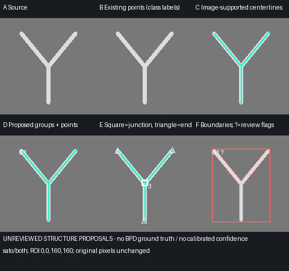
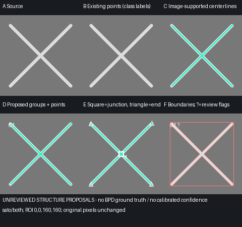
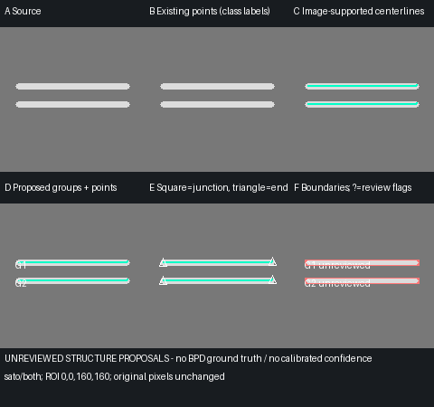

# XRT-RESULT-TD-02 — BPD 구조 검출 실험 및 결과

## Status

**PARTIAL — 연구용 구현 검사 PASS. 실제 BPD 검출 품질 PRELIMINARY / 정답 없음.**

사용자가 검수된 정답 데이터가 없음을 확인했다. 형상·연결·저장·원본 보존 검사는 기술 검증이며, 실제 검출 정확도 승인이 아니다. Precision / Recall / F1 / IoU / Dice / 실제 Skeleton·Branch 일치도 / 실제 False Merge·Miss 비율은 모두 **N/A**다. 신규 구조는 미분류 `RULE_BASED` 제안이며 confidence와 자동 `CONFIRMED`는 생성하지 않는다.

Issue [#98](https://github.com/CrystalVision-Lab/sic-xrt-analyzer/issues/98). 기준은 TD-01의 `feat/96-result-domain-foundation` / `a8ed31aceecd3c583d15bfac10c3010c70f75671`; 작업 브랜치는 `feat/98-bpd-region-detection`. TD-01 Draft PR #97을 기반으로 쌓으며 기존 PR을 병합·rebase·retarget하지 않는다.

## 실행 방법

프로그램 기본 분석과 독립된 명시적 CLI다. D 드라이브 PowerShell에서:

```powershell
cd D:\capstone\sic-xrt-analyzer
.\.venv\Scripts\python.exe -m pip install -e ".[dev,viewer,research]"
.\.venv\Scripts\python.exe tools/experiment_bpd_structure.py `
  --synthetic --preset pilot-v1 --output artifacts/bpd-synthetic-new
```

실제 파일은 `--image <경로> --roi x y width height --settings <JSON> --output <새 폴더>`로 실행한다. `--roi`는 여러 번 지정할 수 있다. `--page`는 0부터 시작하며 TIFF 한 페이지만 읽는다. 세 방식 비교가 기본이고 `--methods sato`로 하나만 선택할 수 있다. 반복은 `--repeats 2`. 기존 프로젝트를 비교할 때 `--project <project.json> --grouping-scope FULL_IMAGE` 또는 `--run-id <id>`를 명시한다. 동일 원본·페이지에 해당하는 단일 run만 사용한다.

`--verify-original-sha`는 사용자가 명시적으로 선택하는 전체 파일 스트리밍 SHA 검사다. TIFF를 열 때마다 자동으로 파일 전체를 해시하거나 Stack을 순회하지 않는다. 출력 폴더가 이미 있으면 실패하며 기존 프로젝트나 원본을 덮어쓰지 않는다. 실제 Crop·프로젝트·실험 출력은 Git에서 제외된 `artifacts/`에 둔다.

## 1. 현재 점 기반 검출 구조

`analysis/research.py`의 원본 대비 기반 Candidate Proposal → 기존 모델용 128×128 RGB uint8 패치 → `analysis/model_adapter.py`의 CPU ONNX 분류 → `analysis/pipeline.py`의 AnalysisResult가 기존 경로다. BPD/TED/TSD class order, 입력 정규화, score/threshold, 후보 제한과 Export를 그대로 사용한다. `results/adapter.py`는 이를 CandidateObservation / ModelPrediction / AnalysisRun으로 변환한다.

`imaging/original_source.py`와 `imaging/image_stack.py`의 원본 ROI Reader, 기존 Region 좌표와 TD-01 도메인 계약을 재사용했다. Viewer Preview·대비값·ImageJ 표시 결과를 검출 입력으로 사용하지 않는다. 이번 구현은 기존 UI·Native Dialog·ONNX 경로를 수정하지 않는다.

## 2. 기존 방식의 한계

점 분류는 선 전체의 시작·끝·곡률·분기를 표현하지 않는다. 여러 점이 하나의 구조에 놓일 수 있으며 128px 패치 확보가 어려운 외곽은 누락 가능성이 있다. 점 수는 실제 물리적 결함 수가 아니다. 새 구조 역시 영상에서 연결된 영역일 뿐 물리적 동일 결함이라는 증거는 아니다.

## 3. 실험 데이터

실제 `After annealing_1.jpg`는 12349×12273 RGB8 원본이다. 기존 모델 BPD 좌표 주변 256·512·1024 ROI와 실제 왼쪽 경계를 포함한 512 ROI를 골랐다. 모델 예측은 정답이 아니며 실제 Y/BPD/무결함 배경이라는 유형 라벨은 부여하지 않았다.

| 사례 | 원본 ROI (x,y,w,h) | 선정 근거 |
|---|---|---|
| JPG R1 | 5980,1166,256,256 | 기존 BPD 점 여러 개와 길게 보이는 어두운 구조 |
| JPG R2 | 3670,5538,512,512 | 기존 BPD·TED·TSD 점과 주변 질감 |
| JPG R3 | 4164,8739,1024,1024 | 기존 BPD 점과 밝은 곡선 구조·질감 |
| JPG R4 | 0,250,512,512 | 실제 왼쪽 이미지 경계를 포함 |

TIFF는 `N119_220_Section_stack_flipped.tif`, `No107_SectionTopo-afterAnnealing .tif`, `No107_SectionTopo-beforeAnnealing.tif`, `No22_220_Section_stack_flipped.tif` 4개, page0의 (1024,1024,512,512)를 처리했다. No107 두 파일은 **big-endian uint16**이며 나머지는 little-endian uint16이다. ImageJ frames를 공간 Z로 간주하지 않는다. 선택 ROI 외의 다른 페이지에서 실제 결함이 없다고 주장하지 않는다.

## 4. 비교 알고리즘

- Local contrast: float32 원본 명암 − Gaussian background, 밝음/어두움 분리, hysteresis, 연결 영역.
- Sato: 명시적 multi-scale Hessian ridge response + 원본 명암 support + 동일 형상 후처리.
- Frangi: 동일 ROI·scale·polarity 조건의 대안 ridge response + 동일 후처리.
- Skeleton은 세 방식 모두 Zhang thinning → 실제 픽셀 연결 → endpoint/junction cluster → graph.

공식 [ridge 필터 비교](https://scikit-image.org/docs/0.25.x/auto_examples/edges/plot_ridge_filter.html), [Frangi API](https://scikit-image.org/docs/0.25.x/api/skimage.filters.html#skimage.filters.frangi), [Skeleton 예제](https://scikit-image.org/docs/0.25.x/auto_examples/edges/plot_skeleton.html)를 참조했다. 의료 영상용 ridge 필터를 XRT 정확도 검증으로 간주하지 않는다. 후보 점을 거리만으로 이어 붙이는 방식은 구현하지 않았다.

## 5. 최종 실험 선택

**Sato + 원본 양측 명암 검사 + Skeleton/Graph**를 구조·분기 표현을 조사하는 잠정 연구 경로로 선택했다. 비교 두 방식은 계속 실행 가능하다. 합성 형상에서 세 방식 모두 기본 구조를 보존했지만 실제 ROI의 출력은 크게 달랐다. Sato는 실제 영상의 질감도 선으로 제안하고 분기를 과도하게 만든다. Frangi는 보수적 설정에서 출력이 사라지는 ROI가 있다. 어느 방식이 실제 BPD에 가장 정확한지는 결정하지 못했다. 제품 기본 분석 활성화 대상으로 선택한 것이 아니다.

## 6. 선형 구조 강조·전처리

RGB8은 원본 decoded sample의 RGB 가중합 [0.2126,0.7152,0.0722] /255, uint16은 원본 sample /65535를 사용한다. big-endian을 수치로 정확히 읽으며 원본 배열·바이트 순서를 바꾸지 않는다. 검출용 float32 복사본만 생성한다. Gray/RGB uint8·uint16만 지원하고 float32 원본은 명시적으로 거부한다. 이 경로의 uint16 연구 결과는 ONNX ModelPrediction이 아니다.

원본 명암 범위 비율인 contrast_floor, Gaussian sigma, scale, hysteresis low/high, 면적·최장 경로 길이·평균 폭·길이/폭·연결 거리·양측 명암 지지 비율·prune 길이를 모두 저장한다. 자동 histogram stretch는 없다. uint16 비교 PNG의 1–99 percentile stretch는 **시각화에만** 사용한다.

명시적 프로필 비교:

| 설정 | pilot-v1 | JPG conservative 비교 | uint16 비교 |
|---|---|---|---|
| scales / polarity / background_sigma | [1,2] / both / 8 | 동일 | 동일 |
| low / high | .10 / .25 | .15 / .35 | .15 / .35 |
| contrast_floor (dtype 범위 비율) | .005 | .01 | .0002 |
| min_area / min_length_px | 12 / 20 | 48 / 24 | 48 / 24 |
| max_width_px / min_aspect | 12 / 3 | 12 / 4 | 12 / 4 |
| link_distance_px / pruning | 4 / 0 | 4 / 0 | 4 / 0 |
| min_ridge_support_fraction | .5 | .5 | .5 |

pilot 초기 실험의 배경 질감·리소스 초과를 보고 conservative 설정을 비교했다. 실제 TIFF sample 명암 범위가 좁아서 별도 contrast_floor를 명시했다. 이 값들은 검증된 운영 임계값이 아니며 전 데이터 공통 최적값이 아니다. 설정 JSON 예시는 아래와 같다. uint16 실험은 contrast_floor만 .0002로 바꾼다.

```json
{"method":"sato","polarity":"both","scales":[1,2],"low_threshold":0.15,"high_threshold":0.35,"contrast_floor":0.01,"background_sigma":8,"min_area":48,"min_length_px":24,"max_width_px":12,"min_aspect":4,"link_distance_px":4,"prune_length_px":0,"min_ridge_support_fraction":0.5}
```

## 7. 영역 후보 생성

각 polarity의 response를 ROI 최대값으로 정규화하고 원본 signed contrast가 floor 미만인 픽셀을 제거한다. hysteresis와 8방향 connected component로 영역을 분리한다. 작은 영역을 먼저 제거하고 연결된 영역을 다시 세며 픽셀 gap closing은 하지 않는다. 밝은 영역과 어두운 영역은 접촉해도 같은 label로 합치지 않는다.

최장 개별 경로 길이·평균 폭·전체 중심선 길이/폭을 검사한다. path tangent에 수직인 양측의 **실제 원본 명암**을 비교하여 반대 polarity halo를 걸러낸다. 양측 sampling radius는 max(3×max_scale,평균 폭+1), contrast 조건은 floor/2, 최소 지지 비율은 명시 설정값이다. ROI 밖 샘플은 만들지 않고 양측 검사 불가능한 구조는 불확실성으로 남긴다. 이 기준도 약한 선·넓은 선을 버릴 가능성이 있다.

## 8. Skeleton

영역 bounding crop에서 Zhang thinning을 수행한다. 면적이 작은 noise를 제외한 뒤 처리한다. 8방향 이웃 중 직교 경로가 이미 있는 corner diagonal을 제거해 삼각형 중복 연결을 줄인다. 실제 대각선 경로는 유지한다. 영상에 없는 긴 chord로 경로를 생성하지 않는다.

## 9. Junction

degree≥3 인접 skeleton 픽셀을 실제 연결 관계로 cluster화한다. 대표는 cluster 중심에 가장 가까운 실제 픽셀이며, 대표→각 exit는 cluster 픽셀 안에서 탐색한 경로를 저장한다. 네 픽셀짜리 junction cluster 회귀 검사로 대표점 chord가 빈 영역을 건너뛰지 않는지 확인했다. degree만으로 실제 물리적 분기를 확정하지 않는다.

## 10. Branch Graph

critical node 사이의 degree2 경로를 추적한다. GraphNode/GraphEdge는 TD-01 계약을 재사용하고 모든 좌표를 원본 x/y로 변환한다. 연결성·참조·끝점·중복 edge 금지·좌표 범위 검증을 기존 도메인에서 수행한다. 닫힌 ring은 세 개의 실제 anchor를 둔 cycle로 저장한다. self/parallel 경로는 실제 중간 픽셀을 추가해 TD-01의 self-edge/중복 edge 금지 계약을 지킨다. cycle은 항상 검토가 필요하다.

## 11. Y자형 보존

합성 Y는 **4 nodes / 3 edges / 1 degree3 junction**의 단일 BRANCHED_GRAPH 제안으로 보존한다. 직선·곡선의 단일 경로는 POLYLINE이다. Y를 세 결함으로 나누거나 하나의 선으로 강제하지 않는다. 실제 데이터의 Y 정답은 없으므로 실제 Y 검출 성능은 N/A다.



## 12. Candidate Grouping

명시적으로 선택한 같은 source/page/run의 **BPD Observation만** 검사한다. 후보의 원본 좌표를 반올림한 픽셀이 동일 accepted component에 있어야 하고 skeleton EDT 거리가 link_distance 이하여야 한다. 같은 이미지 영역과 중심선 근거를 모두 사용하며 공간 거리가 가깝다는 이유만으로 점들을 연결하지 않는다. TED/TSD 후보는 그림에 원래 class로 표시하지만 연결 대상으로 쓰지 않는다.

경로의 국소 방향·곡률은 원본 픽셀 경로와 양측 명암 검사에 반영되지만 별도의 학습된 방향/곡률 identity 판정기는 없다. mask가 threshold 때문에 잘못 붙은 경우 다른 물리적 결함을 하나로 제안할 수 있다. 높은 원래 score로 연결을 확정하지 않는다. 기존 ID/score/Prediction을 수정하지 않는다.

## 13. DefectInstance·저장 연결

`results/bpd_experiment.py:attach_experiment`가 기존 immutable project에 새 Geometry·Instance만 추가한다. POLYLINE 또는 BRANCHED_GRAPH가 primary geometry, 실제 binary 영역은 별도 MASK_REFERENCE PNG다. `GeometrySource.RULE_BASED`, class_label=None, UNREVIEWED, 기본 PROPOSED이며 모호하면 AMBIGUOUS다. ModelPrediction·ReviewEvent·CONFIRMED를 생성하지 않는다. 같은 experiment ID를 재적용할 때 동일 제안은 중복 추가하지 않고 다른 내용으로 이전 ID를 재작성하면 실패한다.

Project schema **1.0.0은 그대로**다. 새 `experiment.json` sidecar schema1.0.0에 알고리즘0.1.0·라이브러리 버전·source/header/page/ROI·원본 ROI byte SHA·시각·실험 ID·전처리·설정·그래프 pruning 전 형상·제거된 경로·연결 근거·검증 상태·단계별 시간·asset SHA를 기록한다. 기존 AnalysisRun을 가짜 rule-based model run으로 확장하지 않는다.

`save_experiment_bundle`은 새 폴더의 sibling staging에서 ProjectStore의 revision/atomic 저장·재불러오기 검증을 사용하고, manifest·mask·비교 이미지 검증 후 폴더를 publish한다. 기존 project/run/review를 덮어쓰지 않는다. 실패 시 소유 staging 경로를 검증하여 정리한다. 재불러오기는 schema/algorithm/source header/page/ROI/참조/경로 이탈/PNG hash·binary값·mask extent를 검사한다. power loss의 디렉터리 fsync나 전원 차단 후 자동 staging 청소, 협력하지 않는 외부 프로세스의 동일 새 출력 경로 경쟁은 완전 보장하지 않는다. 확장 정책을 기존 project 원자 저장 보장과 혼동하지 않는다.

## 14. 원본 좌표 변환

component crop → ROI-local → 원본 좌표로 x,y offset을 정확히 한 번씩 더한다. width/height/dtype/bitdepth/channels/page/file stat identity를 원본 source와 일치시킨다. 파일 전후 identity 검증과 ROI byte SHA로 처리 중 변경을 검출한다. 전체 원본 SHA는 명시적 실험 검증에서만 읽는다. 좌표를 Preview/GPU/Viewer scaling 값으로 변환하지 않는다.

## 15. 경계 처리

`TRUNCATED_AT_ROI_BOUNDARY`와 `TRUNCATED_AT_IMAGE_BOUNDARY`를 구분한다. 실제 영상 외곽 밖으로 선을 외삽하지 않는다. pruning은 ROI 경계에서 잘린 leaf를 보호한다. 이번 실제 R4는 이미지 경계를 포함하지만 accepted structure의 true image boundary 접촉이 없었다. 실제 외곽 BPD 감지는 미검증이고 합성 boundary에서 기술 동작을 확인했다.

## 16. 불확실성·Pruning

degree≥3은 JUNCTION_REQUIRES_REVIEW, degree≥4는 CROSSING_OR_CONTACT_AMBIGUOUS, cycle·짧은 가지·pruning·양측 context 부족도 별도 flag다. 교차/접촉/짧은 가지/cycle/context 부족/삭제 경로의 instance와 링크는 AMBIGUOUS로 남긴다. 순수 Y의 링크는 PROPOSED지만 review_required=True다. 같은 mask라고 실제 동일 결함이라는 확정 판정을 내리지 않는다.

Pruning 기본값은 **0(비활성)**. 사용자가 명시한 길이 아래 leaf→junction 경로만 한 번 제거한다. junction cluster·truncated endpoint를 보호하고 이전 graph 경로/제거 경로/설정을 저장한다. 짧은 실제 결함을 noise로 단정하지 않는다.



## 17. 실제 이미지 결과

JPG 최종 비교: 같은 설정에서 2회 출력 수·형상·연결 수가 일치했다. 총수는 미검수 구조 제안 수다.

| ROI | 방식 | 전체 | Line / Graph | ROI경계 | AMBIGUOUS | BPD 연결 / 점 없는 제안 |
|---|---|---:|---:|---:|---:|---:|
| roi-1 | local_contrast | 0 | 0 / 0 | 0 | 0 | 0 / 0 |
| roi-1 | sato | 3 | 0 / 3 | 2 | 3 | 4 / 1 |
| roi-1 | frangi | 3 | 2 / 1 | 1 | 1 | 1 / 2 |
| roi-2 | local_contrast | 0 | 0 / 0 | 0 | 0 | 0 / 0 |
| roi-2 | sato | 7 | 5 / 2 | 0 | 2 | 0 / 7 |
| roi-2 | frangi | 1 | 0 / 1 | 0 | 1 | 0 / 1 |
| roi-3 | local_contrast | 1 | 0 / 1 | 0 | 1 | 3 / 0 |
| roi-3 | sato | 34 | 11 / 23 | 0 | 23 | 3 / 33 |
| roi-3 | frangi | 0 | 0 / 0 | 0 | 0 | 0 / 0 |
| roi-4 | local_contrast | 0 | 0 / 0 | 0 | 0 | 0 / 0 |
| roi-4 | sato | 10 | 1 / 9 | 0 | 9 | 0 / 10 |
| roi-4 | frangi | 0 | 0 / 0 | 0 | 0 | 0 / 0 |

선택한 FULL_IMAGE run에서 ROI별 기존 점 수: roi-1 5개(BPD 4); roi-2 8개(BPD 1); roi-3 22개(BPD 4); roi-4 4개(BPD 0); 새 count 감소·증가를 검출 정확도 개선으로 해석하지 않는다. 기존 full/ROI run을 섞어서 grouping하지 않았다.

TIFF 4개는 같은 ROI·각 방법 2회에 모두 성공했고 수치가 일치했다. 원래 source dtype uint16/bit_depth16/page_index0 유지, ONNX 실행·Prediction 생성 없음. floor=.01 초회 출력0이 실제 결함 없음이라는 증거가 아니어서 명시적 .0002 조건을 비교했다. .0002에서도 많은 질감 제안이 나타나 실제 품질은 미검증이다.

| TIFF (page0,512 ROI) | 방식 | 구조 / Line / Graph | ROI경계 / 모호 | 처리 s (1회 / 2회) | peak RSS MiB |
|---|---|---:|---:|---:|---:|
| N119 | local_contrast | 100 / 11 / 89 | 23 / 90 | 0.368 / 0.236 | 204.1 |
| N119 | sato | 130 / 54 / 76 | 11 / 76 | 0.607 / 0.808 | 220.8 |
| N119 | frangi | 0 / 0 / 0 | 0 / 0 | 0.688 / 0.625 | 223.7 |
| No107 after | local_contrast | 77 / 5 / 72 | 27 / 73 | 0.315 / 0.292 | 211.2 |
| No107 after | sato | 95 / 36 / 59 | 7 / 60 | 0.606 / 0.572 | 227.9 |
| No107 after | frangi | 0 / 0 / 0 | 0 / 0 | 0.529 / 0.546 | 231.2 |
| No107 before | local_contrast | 79 / 14 / 65 | 20 / 66 | 0.238 / 0.230 | 210.0 |
| No107 before | sato | 135 / 52 / 83 | 13 / 83 | 0.636 / 0.578 | 224.7 |
| No107 before | frangi | 0 / 0 / 0 | 0 / 0 | 0.611 / 0.626 | 229.3 |
| No22 | local_contrast | 95 / 16 / 79 | 37 / 79 | 0.286 / 0.460 | 214.1 |
| No22 | sato | 166 / 86 / 80 | 16 / 80 | 0.691 / 0.553 | 230.6 |
| No22 | frangi | 0 / 0 / 0 | 0 / 0 | 0.521 / 0.514 | 235.7 |

원본 SHA 전후 일치:

- JPG: `c864ce2410e940ee0e5c11faf4bec2f38fa66cf1f8d5ecc4cc15bfa5b60f1c47`
- N119: `434b86d180d1e7238540cde1a81a099670e145dd40ef7a114e75bae7e9b387bb`
- No107 after: `81d5c2a0f795f90a2db1ddee3debf3f570b0e2c8223ab76384d31f21bfcefeb7`
- No107 before: `5d3aa50d204e118ca42ec7b54ff3444bde7406e9a548421042cd01e4272f47f4`
- No22: `e28cf99b4d482f24628cb87f9122b5ae505d73c9fdc5a8bd8b11380fc25542dd`

- ONNX: `24368b8f6613cba5251c0bd8e63d7ddec726d6343a35ed878e823a0091369694`
- Model manifest: `a5a8a3536a491da0f17e39985186957a2bab098acf312d797f8e702dea621a6d`

| 알고리즘 | 선형 구조 | Y자형 | 외곽 검출 | JPG ROI 처리 범위 s | 선택 여부 |
|---|---|---|---|---:|---|
| local_contrast | 합성 PASS / 실제 미검증 | 합성 단일 graph / 실제 미검증 | 합성 PASS / 실제 미검증 | 0.118–1.356 | 비교 경로 유지 |
| sato | 합성 PASS / 실제 미검증 | 합성 단일 graph / 실제 미검증 | 합성 PASS / 실제 미검증 | 0.260–3.678 | 잠정 구조 조사 |
| frangi | 합성 PASS / 실제 미검증 | 합성 단일 graph / 실제 미검증 | 합성 PASS / 실제 미검증 | 0.263–4.245 | 비교 경로 유지 |


육안 출력에서는 R1의 긴 어두운 구조 주변에 작은 가지가 많고 영역이 나뉜다. R2의 기존 BPD 점 주변 짧은 어두운 표식은 보수적 Sato 설정에서 연결되지 않았고 주변 질감 선 7개가 제안됐다. R3의 밝은 곡선에는 BPD 점 3개 연결 제안이 있지만 주변에도 작은 선 제안이 많다. 검수된 정답이 없어 이를 진짜 BPD·오탐·누락으로 수치 확정할 수 없다. 원래 클래스와 새 제안을 독립적으로 볼 수 있는 검토 자료다.

초기 pilot은 배경 질감에서 너무 많은 region/skeleton을 만들어 일부 512/1024 ROI에서 명시적 예산 초과로 중단됐다. 실패 로그와 report는 `artifacts/bpd98-real-pilot`, `artifacts/bpd98-real-final`에 보존했다. 면적 필터 선적용·최장 경로 조건·원본 양측 명암 검사로 halo/짧은 branch 합산 착시를 줄였다. conservative 비교도 잡음을 제거했다는 정확도 승인으로 취급하지 않는다. TIFF 초회 No107 endian 거부 기록과 수정 후 결과도 남겼다. 최종 TIFF 그림은 N119의 수직 질감과 No107의 수평 질감에서 많은 선·junction 제안을 보인다. 이를 BPD 분기나 실제 defect count로 해석할 수 없다.

## 18. 합성 이미지 결과

12종: 직선·곡선·Y·T·교차·분리선·평행선·짧은 가지·경계·낮은 대비·점 noise·빈 영상. 세 방식 ×12의 비교 출력을 생성했다. 기술 기대값: 직선/곡선/weak/boundary 1 line, Y/T/cross/short_branch 1 graph, 분리/평행 2 lines, noise/empty0. 합성 단위 검사는 bright/dark, RGB8/uint16, 양극성 halo, big-endian uint16까지 포함한다. 합성 직선 위 점 3개 연결, 다른 평행선 분리, Y 분기 연결, 교차 AMBIGUOUS, 근거 없는 점·TED 보존을 검사했다. 합성 Shape는 실제 연구 GT가 아니다.



## 19. Before/After 시각화

각 실험의 `comparison.png`: A 원본 / B 기존 점(class 문자) / C 새 중심선 / D 그룹 ID+점 / E 사각형 junction+차수·삼각형 endpoint / F 실제 영역 contour·bbox·검토 flag(?). 색상 외에 문자·도형으로 구분한다. 1024 ROI는 최대512px panel로 축소되므로 PNG가 원본 픽셀 정확도 평가 자료는 아니다; 원본 geometry와 mask가 별도 저장된다.

실제 이미지 Before/After는 Git에 올리지 않았다. 로컬 `artifacts/bpd98-real-conservative/roi-1-sato-1/comparison.png`, `roi-2-sato-1/comparison.png`, `roi-3-sato-1/comparison.png`에서 확인한다. output에 UNREVIEWED / no ground truth를 표시한다. 모델 BPD 점→새 제안의 연결은 영상을 바탕으로 한 검토용 관계다. 선 하나를 완벽하게 묶었다고 보고하지 않는다.

## 20. 처리 시간·CPU

JPG 단계별 반복 평균과 각 총 시간을 분리 기록했다. 단위 seconds.

| ROI / 방식 | total 1회 / 2회 | 원본 읽기 평균 | Skeleton 평균 | Graph 평균 | 양측 명암 평균 | 후보 연결 평균 | CPU core% 평균 |
|---|---:|---:|---:|---:|---:|---:|---:|
| roi-1 / local_contrast | 0.185 / 0.172 | 0.166 | 0.000 | 0.004 | 0.000 | 0.0000 | 100.7 |
| roi-1 / sato | 0.260 / 0.265 | 0.154 | 0.000 | 0.008 | 0.001 | 0.0009 | 95.3 |
| roi-1 / frangi | 0.332 / 0.263 | 0.156 | 0.000 | 0.002 | 0.000 | 0.0006 | 92.1 |
| roi-2 / local_contrast | 0.769 / 0.740 | 0.718 | 0.000 | 0.003 | 0.000 | 0.0000 | 101.5 |
| roi-2 / sato | 1.624 / 1.119 | 0.759 | 0.001 | 0.026 | 0.001 | 0.0014 | 98.9 |
| roi-2 / frangi | 1.312 / 1.122 | 0.730 | 0.000 | 0.001 | 0.000 | 0.0002 | 97.0 |
| roi-3 / local_contrast | 1.356 / 1.257 | 1.146 | 0.001 | 0.015 | 0.000 | 0.0003 | 99.9 |
| roi-3 / sato | 3.637 / 3.678 | 1.209 | 0.015 | 0.290 | 0.004 | 0.0066 | 98.9 |
| roi-3 / frangi | 4.245 / 3.490 | 1.367 | 0.000 | 0.000 | 0.000 | 0.0000 | 99.1 |
| roi-4 / local_contrast | 0.118 / 0.121 | 0.086 | 0.000 | 0.002 | 0.000 | 0.0000 | 104.7 |
| roi-4 / sato | 1.244 / 0.722 | 0.131 | 0.014 | 0.284 | 0.002 | 0.0023 | 96.4 |
| roi-4 / frangi | 1.001 / 0.573 | 0.111 | 0.000 | 0.000 | 0.000 | 0.0000 | 96.3 |


총 시간은 원본 ROI 읽기·전처리·enhancement·threshold/CC·Skeleton·Graph·양측 명암 검사·identity 검증을 포함한다. 단계 시간은 total의 부분집합이며 메모리 allocation/해시 등 나머지가 있다. Graph length는 픽셀 경로 길이 합으로 junction 내부 공유 경로가 중복 포함될 수 있어 물리적 결함 길이로 사용하지 않는다. 후보 연결·domain adapter 시간은 별도다. PNG 렌더·Project serialization·asset 검증·full-file SHA는 처리 시간에 포함하지 않는다. CPU_core_percent=process CPU/실제 경과×100으로 한 코어 기준이며 시스템 전체 CPU%나 FPS가 아니다.

Windows11 10.0.26200, i7-13700(16 cores/24 threads), RAM31.75GiB, Python3.13.7, Qt6.11.2, numpy2.5.3/scipy1.18.1/scikit-image0.26.0, CPU. 파일·환경은 D 작업공간과 C OneDrive 원본이다. 반복은 같은 프로세스의 2회 연속 실행이며 순서 Local→Sato→Frangi; cold cache 측정이 아니다. 초기 pilot은 기존 모델 회귀와 병행했으므로 개선 전후 속도 비교에 쓰지 않는다. 최종 JPG 첫 사례 시작 부분은 짧은 단위 검사와 겹쳤다. 사용자 다른 프로세스/OS cache/thermal 영향을 통제하지 않아 엄밀한 microbenchmark나 통계적 유의 개선을 주장하지 않는다.

## 21. 메모리·리소스 정책

JPG의 전체 실험 프로세스 기준 MiB. 반복 중 최대값을 표시한다.

| ROI / 방식 | peak RSS | peak−before |
|---|---:|---:|
| roi-1 / local_contrast | 214.5 | 3.4 |
| roi-1 / sato | 229.8 | 3.9 |
| roi-1 / frangi | 232.6 | 6.6 |
| roi-2 / local_contrast | 239.6 | 13.2 |
| roi-2 / sato | 249.8 | 18.0 |
| roi-2 / frangi | 255.8 | 23.8 |
| roi-3 / local_contrast | 284.4 | 52.1 |
| roi-3 / sato | 320.7 | 78.7 |
| roi-3 / frangi | 340.0 | 97.1 |
| roi-4 / local_contrast | 247.4 | 9.1 |
| roi-4 / sato | 250.7 | 17.0 |
| roi-4 / frangi | 256.0 | 22.3 |


psutil 프로세스 RSS를 10ms마다 샘플링하여 before/peak/after를 기록했다. NumPy/native allocation을 포함하지만 순간 peak를 놓칠 수 있고 이 값은 새 알고리즘만의 exclusive RAM이 아니다. 비교 PNG 생성·저장 단계는 RSS 측정 범위 밖이다. 전체 Stack을 읽지 않는다. ROI Reader API 한 번 호출을 검사했고 TIFF는 기존 영역 memmap 경로를 사용한다. Qt JPEG codec 내부 decode 전략까지 제한하는 새 decoder는 만들지 않았다.

ROI 최대4,194,304px, qualified regions 최대2,000, 두 polarity 누적 skeleton 최대100,000px, raw noise component 최대100,000개를 넘으면 명시적 오류다. 예산을 끄는 설정은 거부한다. cancellation은 단계/영역 사이에 확인하며 이미 시작한 native Gaussian/Hessian 연산을 즉시 중단하지 못한다. 이 서비스는 동기 CPU 연구 API이며 UI worker 연결은 이번 단계에 없다.

## 22. 기존 결과 보존

실제 고정 모델 재실행은 FULL_IMAGE 2946(BPD245/TED1398/TSD1303), ROI(1003,1011,1495,1495) 791(BPD3/TED779/TSD9)로 이전 값과 같다. 기존 JSON/CSV Export bytes, IDs·원본 좌표·score·metadata·원본/manifest/model SHA, project roundtrip를 검사했다. `artifacts/result98-legacy/report.json`은 PASS다.

새 실험의 기존 `artifacts/result96-real/project.json` entry bytes와 immutable observation/prediction/run/review tuple이 전후 같음을 검사했다. 새 제안은 별도 bundle에만 추가한다. 기존 project schema1.0.0, rawscore의 calibration 상태, 모델 버전과 training metadata를 재작성하지 않는다. 실제 TIFF는 모델 입력 계약을 자동 변환해 통과시키지 않는다. 모델·JPG SHA 값은 아래 실험 보존 기록에 남겼다.

## 23. 회귀 결과

| 항목 | 결과 |
|---|---|
| Ruff / compileall / wheel | PASS, 새 4개 모듈 wheel 포함 |
| 신규 Unit / Geometry / Grouping / Provenance / Persistence | 55 passed, 15.25s, 신규 skip 없음 |
| 합성 12종 ×3방법 CLI | 36 실행 PASS, 실제 품질 지표 아님 |
| 실제 JPG ROI 4×3×2 | 24 실행 PASS, 동일 반복 count/geometry 구조/연결 수 |
| 실제 TIFF 4×3×2 | 24 실행 PASS, uint16 양 endian, 원본 SHA 동일 |
| 실제 기존 RGB 모델 / Export / Project | FULL2946 / ROI791 / 기존 bytes·SHA·IDs·좌표·score 보존 PASS |
| Windows 전체 pytest | 462 passed, 5 skipped, 442.94s |
| Windows Native Plugin | 최초 3 passed/1 failed, 39.60s → 동일 조건 재실행 4 passed/5 deselected, 23.06s |
| 최종 HEAD GitHub CI | 연결된 Draft PR 본문·Checks의 실제 결과 참조 |

로컬 전체 회귀 런타임 commit은 `dd31a8015fc909f16e9a06346fd6e5301461c04d`다. 이후 변경은 README/이 보고서/합성 PNG만이며 런타임·tests·dependency 파일이 같음을 diff로 확인한다. 최종 docs HEAD에서 Linux CI 전체 pytest·Native plugin·Ruff·compile·wheel을 다시 검사한다.

Windows skip5는 기존 offscreen GUI4와 symlink 권한1이다. 별도 Windows 모드에서 GUI4를 실행했다. **최초 Native Swing 이동 실패는 숨기지 않는다**: 부모 x가20 이동한 후 QTest 100ms에서 container x30(expected50)이었다. 기존 코드는 80ms timer로 ancestor geometry를 동기화하며 실패 원인은 확정하지 못했다. 동일 코드/환경 재실행은 4개가 통과했으나 반복 안정성까지 확정하는 결과는 아니다. 최초 `artifacts/bpd98-native.log`와 재실행 `bpd98-native-repeat.log`를 보존한다. 이 TD의 신규 연구 서비스 검사 PASS와 기존 Native 창의 잔여 timing 문제를 구분한다.

전체 로그 `artifacts/bpd98-full-pytest.log`, wheel `bpd98-wheel.log`, 신규 `bpd98-unit-v7.log`. 실제 실험과 원본 보존은 각 bundle/manifest/report 및 `artifacts/result98-legacy/report.json`에 있다.

기존 테스트를 삭제하거나 새 skip으로 PASS를 만들지 않았다. 신규 영역 검사는 기존 Result Domain / Project Persistence / Geometry / ReviewEvent / Analysis / Export / ROI / TIFF / ImageJ/Fiji 검사를 그대로 유지한 전체 pytest에 추가된다. Native plugin 검사는 실제 Windows QPA로 별도 실행하며 인간의 마우스 조작 Acceptance와 구분한다. 원본·sources/·Native Dialog·Viewer/QML 변경은 없다. AGENTS.md의 사용자 변경은 stage하지 않고 SHA 보존을 확인한다.

## 24. 한계·후속 연구

실제 GT가 없고 검수된 유형별 표본이 없다. 현재 scale/threshold/width/length는 실험 값이다. 실제 영상에서 noise branch·fragmentation·contact false merge·weak/wide ridge omission이 가능하다. point grouping은 반올림 픽셀의 component membership에 의존하고 별도 물리적 direction/curvature identity 검증이 없다. 자동 BPD 라벨·성능 향상·확정 결함 수·정확도 지표를 주장할 수 없다.

기존 Native Swing ancestor 이동의 100ms 검사 실패는 동기화 timer·event scheduling 원인을 별도 안정성 조사로 확인할 필요가 있다. 이번 TD에서 Native 코드를 고치거나 테스트 대기시간을 늘려 통과시키지 않았다.

다음 우선순위는 연구원이 원본 ROI의 Polyline/Mask/Graph와 같은 결함/다른 결함 관계를 검수하는 것, 유형별 원본 표본을 확보하는 것이다. 알고리즘 파라미터·pruning을 고정 평가셋으로 비교하고 image-supported connection과 물리적 defect identity를 분리해야 한다. 연구 모델 학습·정량 평가 데이터 파이프라인은 각 담당 저장소에 별도 Issue로 진행한다.

## 25. 다음 TD 연계

제품 기본 Result 화면의 영역 중심 개편은 **실제 품질 검증 이후** 진행한다. 지금은 CLI bundle을 명시적으로 불러온 연구 검토용 표시를 계획할 수 있다. 실제 GT 확보 없이 PROPOSED를 CONFIRMED로 승격하거나 모델 BPD count를 새 객체 count로 대체하지 않는다. 서버·학습·전체 이미지 자동 분석·Stack tracking·3D는 이번 구현 범위가 아니다.

# XRT-RESULT-TD-02 Result

### Status

PARTIAL. 기술적 구현/검증 상태와 실제 품질 PRELIMINARY는 위 실험·회귀 기록을 각각 따른다. GT 없음, Precision/Recall/F1/IoU 및 실제 Skeleton·Branch 일치 N/A.

### 기존 방식 / 새 알고리즘

기존 128×128 RGB 모델 분류 보존. 명시적 ROI의 Local contrast/Sato/Frangi를 비교하고 원본 명암 지지→Skeleton→Graph→DefectInstance를 별도 구현했다. Sato는 잠정 실험 경로이며 운영 검출기로 승인되지 않았다.

### 검토한 알고리즘 비교 / 원본 데이터 / 검출 결과

§3–7, §17–18 및 아래 실행 기록의 표를 참조한다. 원본은 JPG1개와 TIFF4개, 합성12종이다. 후보 수·분기 구조 수는 미검수 영상 제안 수이며 실제 BPD 수가 아니다.

### Candidate Grouping / DefectInstance / Geometry

§12–16. 동일 실제 component + skeleton 거리, PROPOSED/AMBIGUOUS만. class_label=None/RULE_BASED/UNREVIEWED. POLYLINE, BRANCHED_GRAPH, binary MASK_REFERENCE 저장·재불러오기. 기존 CandidateObservation와 ModelPrediction 유지.

### 실제 BPD 사례 / Before/After / 기존 모델 비교

§17–19. 실제 영상의 구조와 기존 BPD 분류 점을 비교했지만 실제 BPD 정답 사례로 확정하지 않았다. 원본/점/중심선/그룹/분기/불확실성 6패널 PNG는 로컬 artifacts에 보존한다. 합성 이미지만 Git에 포함한다.

### 검출 정확도 / 잘못된 병합 / 누락

GT 없음. 실제 Precision/Recall/F1/IoU/Dice/false merge/miss 모두 N/A. 실제 출력의 texture·과다 branch·fragmentation·짧은 구조 제외 가능성을 확인했다. 합성 평행/분리선은 서로 다른 영역, 교차는 AMBIGUOUS. 이 기술 검사가 실제 BPD identity 정답을 대체하지 않는다.

### 처리 성능 / 메모리 / 기존 결과 무결성 / Project Persistence

§13, §20–22. 단회와 반복은 분리 기록한다. 원본 한 ROI만 읽고 자원 제한을 지키며 원래 2946/791 후보·점수·좌표·Export bytes·검수 이력을 보존한다. 명시적 SHA 결과와 단계별 시간은 아래 기록 및 로컬 manifest에 있다.

### 테스트 / 기술적 한계 / 후속 TD

§23–25. Unit·Integration·Geometry·Grouping·실제 Data·전체 Regression·Native·CI는 각각 검사한다. 기술 검증 성공은 실제 정확도 PASS가 아니다. GT 확보·유형별 validation이 우선이며 제품 UI 영역 중심 개편은 후속이다.

### Git

- 시작 Branch: `feat/96-result-domain-foundation`
- 시작 HEAD: `a8ed31aceecd3c583d15bfac10c3010c70f75671`
- 작업 Branch: `feat/98-bpd-region-detection`, base는 시작 Branch
- 구현 Commit: `d88f180` ROI/Graph / `61a9cd9` Adapter·실험 저장 / `151a592` 검사·CLI / `dd31a80` uint16 endian / 이 보고서의 docs commit
- Push / Draft PR / 최종 HEAD / CI URL: 연결된 Draft PR 본문에 실제 값을 기록한다. 기존 stacked PR은 유지한다.
- Working Tree: 본 TD 변경은 commit하고 기존 사용자 `AGENTS.md`만 남긴다.
- AGENTS SHA: `97fd9e0886957e532cfd5bafd525263462dc6e90652cf2b43ce6d3404fc04eaf` 보존.
